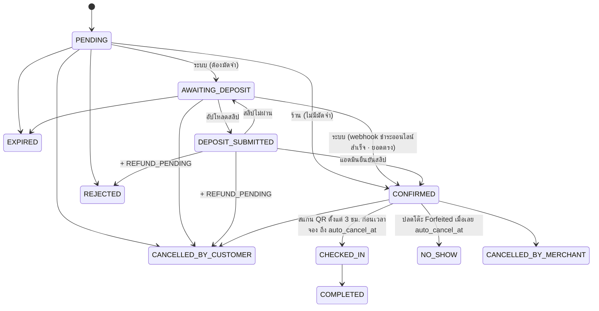

# NightOut — Database Design

> สถานะ: **v1.1** (ทำตาม [`DATABASE_CHANGES.md`](DATABASE_CHANGES.md)) · ใช้คู่กับ [`ARCHITECTURE.md`](ARCHITECTURE.md) และ [`SITEMAP.md`](SITEMAP.md)
> Migration: `apps/backend/supabase/migrations/20261002000100_*.sql` … `20261002001500_*.sql` (15 ไฟล์ แยกตามโดเมน)
> Seed: `apps/backend/supabase/seed.sql` (master data + ร้านเดโม 16 ร้าน — สร้างด้วย `db:seed:gen`)
> Types: `packages/types/src/database.generated.ts` (จาก `supabase gen types` — ห้ามแก้มือ) + `database.ts` (override ของ view) → `import { Db } from '@nightout/types'`
> migration ทีมรุ่นแรก (0001–0003) เก็บไว้อ้างอิงที่ `docs/legacy-migrations/`

---

## 1. หลักการ

| # | หลักการ | ทำอย่างไร |
|---|---|---|
| 1 | ตัวตนผู้ใช้ = `auth.users.id` | `users.id` FK → `auth.users` · เบอร์โทรไม่ใช่ key (`users.phone_e164` ยังไม่บังคับ ใช้เมื่อเปิด OTP) |
| 2 | ชื่อคอลัมน์เต็ม ไม่ย่อ | `grace_minutes`, `min_advance_minutes`, `max_advance_days` … |
| 3 | enum ตัวพิมพ์ใหญ่ทั้งหมด | รวม `pr_gender` = MALE / FEMALE / LGBTQ · `fee_calc` = PERCENTAGE / FIXED_PER_TABLE / FIXED_PER_PERSON |
| 4 | key ที่หน้าบ้านได้รับ = ชื่อหลังบ้าน (snake_case) | ไม่มีชั้นแปลงชื่อ · ข้อยกเว้นเดียว: key ใน `pr_counts` เป็นตัวเล็ก |
| 5 | อ่านผ่าน view/RPC ตรง · เขียนผ่าน NestJS เท่านั้น | RLS มีแค่ `SELECT` · `revoke insert/update/delete` จาก `anon`, `authenticated` ทุกตาราง |
| 6 | หนึ่งหน้า = หนึ่งการเรียก | view 7 ตัว + RPC 2 ตัว ในหัวข้อ 5 · ใช้กฎ "ไม่มีข้อมูล" |
| 7 | กฎสำคัญอยู่ใน DB | exclusion constraint, composite FK, trigger transition, unique กันซ้ำ |
| 8 | snapshot สิ่งที่ลูกค้าเห็นตอนจอง | ราคา / แพ็กเกจ / โปร / มัดจำ / grace |
| 9 | PDPA | ไม่เก็บพิกัดผู้ใช้, IP เป็น hash, เลขบัญชีเข้ารหัส, สลิป/เบอร์ลบตาม retention, job anonymize บัญชีที่ลบ |

**กฎตาราง:** ตารางหลักมี `id`, `created_at`, `updated_at` + trigger `set_updated_at` · ข้อยกเว้น: ตารางเชื่อม PK คู่ (`bar_styles`, `favorites`) และตาราง log `bigint identity` (`audit_logs`, `job_runs`, `booking_status_history`, `crowd_status_logs`, `review_moderation_logs`) · ตาราง 1:1 (`user_preferences`, `bar_booking_settings`, `bar_stats`, `bar_live_status`) ใช้ FK เป็น PK

---

## 2. Migration (แยกตามโดเมน)

| ไฟล์ | เฟส | เนื้อหา |
|---|---|---|
| `…000100_extensions_enums` | 1 | extensions (pgcrypto, btree_gist, citext, pg_trgm, **postgis**, pg_cron, pg_net → schema `extensions`) · enums · `set_updated_at()` |
| `…000200_users_notifications` | 1 | users, legal_documents, user_consents, user_preferences, notification_channels, notifications, notification_deliveries, audit_logs, job_runs · trigger สมัครสมาชิก |
| `…000300_master_data` | 1 | districts, styles, safety_features, platform_settings (ข้อมูลอยู่ใน seed) |
| `…000400_bars` | 1 | bars + **bar_booking_settings / bar_stats / bar_live_status** (1:1) + **bar_pr_counts** + bar_staff, hours, special_hours, styles, media, links, verifications, payout_accounts, safety_features · helper RLS |
| `…000500_menu_pricing` | 1 | menu_categories, menu_items, bar_fees, price_packages, price_package_items, bar_promotions |
| `…000600_tables_bookings` | 1 | table_zones, tables, bookings (+ composite FK, exclusion), status history, snapshots, booking_promotions, qr_tokens, checkins · transition · `zone_remaining_pax` |
| `…000700_reviews_favorites` | 1 | reviews, review_media, review_reports, review_moderation_logs, favorites |
| `…000800_views_rls_storage` | 1 | **view 7 ตัว + search_bars / nearby_bars** · RLS · สิทธิ์คอลัมน์ · Storage 6 buckets · Realtime |
| `…000900_deposits_payouts` | 2 | deposits, bar_payouts, bar_credit_ledger — **DRAFT** (รอข้อ 10.3) · คืนเงินอัตโนมัติเมื่อยกเลิกระหว่างรอตรวจสลิป |
| `…001000_sharing_safety_crowd` | 2 | booking_shares, booking_share_joins, `get_share_card`, safety_reports, crowd_status_logs → `bar_live_status` |
| `…001100_ranking` | 2 | tier_scores, editor_picks (ลบใน `…20261008000400`) |
| `…001200_promoted_listings` | 2 | promotion_packages, promoted_listings, payments, stats · `bar_is_promoted()` ตัวจริง |
| `…001300_billing` | 2 | commission_rules, invoices, billing_events |
| `…001400_retention_jobs` | 2 | `run_retention_jobs()` (PDPA) + วิธีตั้ง pg_cron (บรรทัด `/api/jobs/tier?period=WEEKLY` ในหัวไฟล์ถูกแทนด้วย job ทุกคืนใน `…20261013001030`) |
| `…001500_fk_indexes_final` | — | index บน FK ทุกตัว (63 ตัว สร้างจาก catalog) · เปิด RLS · revoke write |
| `…001600_admin` | Backoffice | `is_admin()` (ADMIN + MFA aal2) · policy `admin_read` ทุกตาราง · view `admin_*` 9 ตัว · `rpc('admin_dashboard')` · ฟังก์ชันการกระทำ `admin_*` 8 ตัว (service_role เท่านั้น + audit log) |
| `…001700_app_actions` | แอปจริง | ฟังก์ชันการกระทำของลูกค้า/ร้าน `app_*` 26 ตัว (service_role เท่านั้น เรียกผ่าน NestJS) · trigger ผลของสถานะการจอง (มัดจำ → รอโอน/รอคืน, เช็กอิน, ค่าคอม, แจ้งเตือน) · `run_booking_timeouts()` · view `my_bar_detail` / `my_reviews` / `admin_bar_promotions` · RPC `zone_availability`, `bar_deposit_ledger`, `bar_team`, `my_invites` · `booking_detail` เพิ่ม `customer_name, share_token, has_review` |
| `…20261003000200_admin_create_user` | Backoffice เพิ่มผู้ใช้ | ฟังก์ชัน `admin_finish_new_user` (ตั้ง role + ผูกร้าน + audit · service_role) |
| `…20261003000100_admin_team_members` | Backoffice จัดการทีมงาน | view `admin_team_members` · policy `admin_read` บน team_members · ฟังก์ชัน `admin_save/delete/reorder_team_member(s)` (service_role) · bucket `team-photos` (public · เขียนได้เฉพาะแอดมิน + MFA) |
| `…20261007000100_site_content_home` | Backoffice แก้หน้าแรก | ตาราง **home_content** (แถวเดียว: Hero หัวข้อ 3 ท่อน/คำโปรย/ช่องค้นหา/ภาพ · ชื่อ section หมวด) · **home_categories** (การ์ดหมวด 8 slot ตายตัว: ชื่อ/คำอธิบาย/ลิงก์/ภาพ/ป้าย — ไอคอนลบใน `…20261008000100`) · view `public_home_content` / `public_home_categories` (anon) · `admin_home_content` / `admin_home_categories` · ฟังก์ชัน `admin_save_home_content` / `admin_save_home_category` (service_role · audit) · bucket `site-media` (public · เขียนได้เฉพาะแอดมิน + MFA) · seed = เนื้อหาเดิมของหน้าแรก |
| `…20261008000100_site_content_drop_category_icon` | หน้าแรกไม่มีไอคอนหมวด | ลบคอลัมน์ `home_categories.icon` · สร้าง view `public_home_categories` / `admin_home_categories` ใหม่ (ไม่มี icon) · `home_category_check` / `admin_save_home_category` ไม่ตรวจ/ไม่เขียน icon |
| `…20261008000400_bar_drop_editor_pick` | ตัด Editor's Pick | ลบ `bar_stats.is_editor_pick` · ตาราง `editor_picks` · `admin_set_editor_pick` · drop + สร้างใหม่ `bar_cards` / `bar_detail` / `my_favorites` / `search_bars` / `nearby_bars` / `my_bar_detail` / `admin_bars` (ไม่มี is_editor_pick · สิทธิ์เดิม) · `admin_bars` + `promoted_until` (วันหมดโปรโมทที่กำลังแสดง) |
| `…20261009000100_bar_media_images` | รูปร้าน + รูปเมนู | ไฟล์อยู่ bucket `bar-media` (`<bar_id>/gallery/…` · `<bar_id>/menu/…`) · storage policy `bar-media: admin *` (แอดมิน + MFA อัปโหลดแทนร้าน) · `bar_media_save` แทนที่แกลเลอรีทั้งชุด (สูงสุด 10 · ไฟล์ต้องอยู่ใน Storage จริง · ปก = หนึ่งในแกลเลอรี → `bars.cover_image_url` = URL เต็มที่ NestJS สร้าง) · `app_set_bar_media` (เจ้าของ/ผู้จัดการ · `app_audit`) · `admin_set_bar_media` / `admin_set_menu_item_image` (audit ก่อน/หลัง + แจ้งทีมร้าน `BAR_MEDIA_UPDATED`) · `app_set_menu` ตัวใหม่รับ `image_path` (ไม่ส่ง key = คงรูป · null = ลบ) · ทุกตัวคืน `removed_paths` (`bar_media_unused`) ให้ NestJS ลบไฟล์ · `my_bar_detail` + `media` · view `admin_bar_media` |
| `…20261010000100_community_threads` | ชุมชน/กระทู้ (นอก MVP — อนุมัติ 2026-10-10) | ตาราง **community_categories** (seed 6 หมวด · `staff_only` = ประกาศ ตั้งได้เฉพาะทีม NightOut) · **community_threads** (แท็กร้าน 1 ร้าน · status PUBLISHED/HIDDEN/REMOVED/DELETED · ตัวนับ reply/like/view) · **community_comments** (ตอบกลับ 1 ชั้น) · **community_thread_likes** / **community_comment_likes** / **community_saves** · **community_pins** (ปักหมุดส่วนตัว สูงสุด 3 · เห็นเฉพาะเจ้าของหมุด) · **community_drafts** (ร่าง NEW 1/บัญชี · REPLY/EDIT 1/กระทู้ · payload jsonb ≤ 32KB · เกิน 7 วันไม่คืน/ลบตอนบันทึก) · **community_reports** · อ่าน (security definer · anon+authenticated): `community_feed` (scope all/mine/saved/pinned · หมุดของฉันขึ้นก่อน) · `community_thread` · `community_categories_list` · `community_trending_bars` · `my_community_drafts` · เขียน `app_community_*` 12 ตัว + `community_add_view` · `admin_community_moderate` (audit + แจ้งเจ้าของ) · view `admin_community_threads` / `admin_community_comments` · แจ้งเตือน `COMMUNITY_REPLY` / `COMMUNITY_REPORTED` / `COMMUNITY_MODERATED` |
| `…20261011000100_community_media` | ชุมชน: แนบรูป/วิดีโอ | bucket **community-media** (private · 60MB · `<user_id>/<ไฟล์>` · storage policy: อ่าน = เจ้าของ / แอดมิน / `community_media_path_is_public` (กระทู้+ความเห็นแสดงอยู่) · เขียน/ลบ = เจ้าของโฟลเดอร์) · ตาราง **community_media** (1 แถว/ไฟล์ของกระทู้หรือความเห็น · วิดีโอ ≤ 60 วิ · ภาพปก `thumb_path`) · `community_comments.body` ว่างได้ (ต้องมีข้อความหรือไฟล์) · `community_media_norm` ตรวจรายการไฟล์ (≤ 6 · ในโฟลเดอร์เจ้าของ · มีใน Storage จริง) · ลายเซ็นใหม่ (drop ตัวเดิม) `app_community_create_thread(…, p_media)` · `app_community_update_thread(…, p_media null = คงเดิม)` · `app_community_add_comment(…, p_media)` · ร่าง `payload.media` · ทุกฟังก์ชันเขียนคืน `removed_paths` (`community_paths_unused`) ให้ NestJS ลบไฟล์ · `community_thread` + `media` · view `admin_community_*` + `media` |
| `…20261011000200_review_allow_confirmed` | รีวิวไม่ต้องเช็กอิน | `app_add_review` + trigger `check_review_booking` รับการจองสถานะ `CONFIRMED` / `CHECKED_IN` / `COMPLETED` / `NO_SHOW` (มัดจำผ่านแล้ว · = `REVIEWABLE_BOOKING_STATUSES` ใน `@nightout/utils`) · error `REVIEW_REQUIRES_BOOKING` แทน `REVIEW_REQUIRES_CHECKIN` |
| `…20261012000100_bar_save_page_batch` | บันทึกทั้งหน้าครั้งเดียว (ร้าน) | `admin_set_bars_status(p_actor, p_changes jsonb)` แสดง ↔ ระงับหลายร้านในธุรกรรมเดียว (เรียก `admin_set_bar_status` ทีละร้าน · รับเฉพาะร้าน APPROVED/SUSPENDED → `BAR_NOT_TOGGLEABLE` · ระงับต้องมีเหตุผล → `INVALID_BAR_STATUS_CHANGES`) · `admin_save_bar_media(p_actor, p_bar, p_paths, p_cover_path, p_cover_url, p_menu jsonb)` แกลเลอรี (null = ไม่แตะ) + รูปเมนูหลายรายการ (`[{id, path\|null}]` · เมนูต้องเป็นของร้านนั้น) · audit ต่อเรื่อง + แจ้งทีมร้าน 1 ครั้ง · `app_save_bar_store(p_actor, p_bar, p_info jsonb, p_paths, p_cover_path, p_cover_url)` = `app_update_bar_info` + `app_set_bar_media` (`INVALID_BAR_STORE` ถ้าไม่ส่งอะไร) · ทุกตัวคืน `removed_paths` ให้ NestJS ลบไฟล์ |
| `…20261012000200_site_team_save_page` | บันทึกหน้า /team ครั้งเดียว | `admin_save_team_page(p_actor, p_ids uuid[], p_active jsonb)` = `admin_save_team_member` ต่อแถวที่สลับแสดง (สิทธิ์ต่อแถวเดิม) + `admin_reorder_team_members` (Super Admin) ในธุรกรรมเดียว · `INVALID_TEAM_PAGE` ถ้าไม่ส่งอะไร |
| `…20261012000300_account_set_users_role` | บันทึกชั้นบัญชีหลายคนครั้งเดียว | `admin_set_users_role(p_actor, p_changes jsonb)` = `admin_set_user_role` ทีละคน (`[{id, role}]`) ในธุรกรรมเดียว · Super Admin เท่านั้น · คนไหนพลาด (เช่น `LAST_SUPER_ADMIN`) = ไม่บันทึกเลย · `INVALID_ROLE_CHANGES` (ว่าง/ซ้ำ) |
| `…20261012000400_bar_save_safety` | บันทึกหน้า /merchant/safety ครั้งเดียว | `app_save_safety(p_actor, p_bar, p_items jsonb)` (`[{key, value?, evidence_path?}]`) — ค่าใหม่ผ่าน `app_set_safety` (กลับเป็น SELF_DECLARED + คิดคะแนนใหม่) · หลักฐานเก็บ `evidence_path` (ต้องอยู่ใน `bar-verifications/<bar_id>/…` → `INVALID_EVIDENCE_PATH`) · `app_audit` + แจ้งแอดมิน 1 ครั้งต่อการบันทึก · `INVALID_SAFETY_ITEMS` (ว่าง/ซ้ำ/ข้อไม่มีทั้งค่าและหลักฐาน) |
| `…20261012000500_bar_save_promotions_page` | บันทึกหน้า /merchant/promotions ครั้งเดียว | `app_save_promotions_page(p_actor, p_bar, p_items jsonb, p_fees jsonb)` = `app_set_bar_promotions` (โปรทั้งชุด · null = ไม่แตะ) + `app_set_fees` (`{service_charge, vat, other}` · null = ไม่แตะ) ในธุรกรรมเดียว · `INVALID_PROMOTIONS_PAGE` ถ้าไม่ส่งอะไร |
| `…20261012000600_site_content_save_home_page` | บันทึกหน้า /home-content ครั้งเดียว | `admin_save_home_page(p_actor, p_content jsonb, p_categories jsonb, p_popular uuid[])` = `admin_save_home_content` (null = ไม่แตะ) + `admin_save_home_category` ต่อการ์ดที่แก้ (`[{slot, …}]` ไม่ซ้ำ) + `admin_save_home_popular` (null = ไม่แตะ · `'{}'` = ไม่ปัก) ในธุรกรรมเดียว · `INVALID_HOME_PAGE` (ว่าง/การ์ดซ้ำ) |
| `…20261012000700_bar_save_settings_page` | บันทึกหน้า /merchant/settings ครั้งเดียว | `app_save_settings_page(p_actor, p_bar, p_settings jsonb, p_payout jsonb)` = `app_update_booking_settings` (เจ้าของ/ผู้จัดการ) + `app_set_payout_account` (`{bank_code, account_name, account_no_enc, last4}` · เจ้าของ/ผู้จัดการ ตาม requirement — comment ในไฟล์ migration ที่เขียนว่า "เจ้าของเท่านั้น" ไม่ตรงกับโค้ด) ในธุรกรรมเดียว · `INVALID_SETTINGS_PAGE` |
| `…20261012000800_community_edit_history` | ชุมชน: แก้ความเห็น + ประวัติการแก้ไข | `community_comments.edited_at` · ตาราง **community_revisions** (1 แถว = เวอร์ชันที่ถูกแก้ทับของกระทู้หรือความเห็น · title/category/bar_id เฉพาะกระทู้ · `media` snapshot + `media_paths` generated + GIN · `version_at` / `replaced_at` · RLS admin_read) · `app_community_update_comment(p_actor, p_comment, p_body, p_media null = คงเดิม)` เจ้าของเท่านั้น · `app_community_update_thread` เก็บเวอร์ชันเดิมก่อนแก้ (และตั้ง `edited_at`) เฉพาะเมื่อเนื้อหาเปลี่ยนจริง · ร่าง `EDIT_COMMENT` (1/กระทู้ · `payload.comment_id` = ความเห็นของฉัน) · อ่าน `community_history('THREAD'\|'COMMENT', id)` (security definer · anon+authenticated · เห็นได้เท่ากับที่เห็นกระทู้/ความเห็น · แอดมินทุกสถานะ) · ไฟล์ของเวอร์ชันเดิมยังอยู่ (`community_paths_unused` นับประวัติ · `community_media_path_is_public` เปิดอ่านไฟล์ในประวัติ) · เจ้าของลบกระทู้/ความเห็น = ลบประวัติ + ไฟล์ · `community_thread` ความเห็นมี `edited_at` · view `admin_community_threads` + `revisions` · `admin_community_comments` + `edited_at`, `revisions` |
| `…20261013000100_bar_team_money_rbac` | Staff/PR ห้ามเห็นเงินของร้าน | `is_bar_manager(bar)` (เจ้าของ/ผู้จัดการที่ตอบรับแล้ว) แทน `is_bar_member` ใน RLS `bar_payout_accounts` · `bar_payouts` · `bar_credit_ledger` · `commission_rules` · `invoices` · `billing_events` · `promoted_listing_payments` + rpc `bar_deposit_ledger` → Staff ได้แถวว่าง · `my_bar_detail.payout_account` เป็น null ให้ Staff (security_invoker) · การจองรายใบทีมร้านทุกบทบาทยังเห็น |
| `…20261013000200_backoffice_super_admin_reads` | Super Admin | `is_super_admin()` (SUPER_ADMIN + aal2) · `audit_logs.admin_read` + view `admin_audit_logs`: แอดมินไม่เห็นแถว `actor_role = SUPER_ADMIN` · Super Admin เห็นทั้งหมด · `admin_read` ของ `billing_events` / `invoices` / `commission_rules` + view `admin_billing_events` → Super Admin เท่านั้น |
| `…20261013000300_booking_share_card_fee` | ลิงก์หารเงิน | `get_share_card` คืน `deposit_required` เพิ่ม (drop + create) — หน้า /share หาร Table Fee ต่อหัว · grant anon/authenticated/service_role |
| `…20261013000400_bar_promotions_no_alcohol` | ข้อกฎหมายแอลกอฮอล์ | แก้โปรของร้านเดโมที่ข้อความตรงกับ seed เดิม ("โปรเบียร์ก่อน 2 ทุ่ม" → "มาก่อน 2 ทุ่ม มิกเซอร์ 4 จ่าย 3" · Ladies Night "ค็อกเทลแก้วแรกฟรี" → "ของทานเล่นฟรี 1 จาน") — ข้อมูลอย่างเดียว ไม่เปลี่ยน schema |
| `…20261013000500_booking_timing_rules` | กติกาเวลาการจอง (เจ้าของอนุมัติ 2026-10-13) | `bookings.extended_at` (+ grant select ให้ authenticated) · `bar_booking_settings.refund_before_hours` ค่าเริ่มต้น 6 + ตั้งทุกร้านเป็น 6 (โต๊ะทั่วไปคืน Table Fee เต็มเมื่อยกเลิก ≥ 6 ชม.) · trigger **`bookings_check_in_window`** (`booking_check_in_window()` BEFORE UPDATE OF status → CHECKED_IN ได้ตั้งแต่ 3 ชม. ก่อนเวลาจองถึง `auto_cancel_at` ตามเวลา server · `CHECK_IN_TOO_EARLY` / `CHECK_IN_TOO_LATE` · บังคับทุกทาง QR/รหัส/ทีมร้าน/แอดมิน) · `app_extend_booking(p_actor, p_booking)` ขอต่อเวลา 15 นาที 1 ครั้ง (CONFIRMED · ตั้งแต่ 15 นาทีก่อนเวลาจองถึงเวลาปลดโต๊ะ → `auto_cancel_at` + 15 นาที · `BOOKING_ALREADY_EXTENDED` / `BOOKING_EXTEND_NOT_AVAILABLE` · audit + แจ้งทีมร้าน `BOOKING_EXTENDED`) · `app_join_share(p_actor, p_token)` เพื่อนกด "ไปด้วย" (`booking_share_joins` ไม่นับซ้ำ · แจ้งผู้จอง `SHARE_JOINED` · `SHARE_NOT_FOUND` / `SHARE_CLOSED`) · `get_share_card` + `is_member` / `checkin_qr` (`NIGHTOUT:<booking id>` เฉพาะสมาชิก + CONFIRMED — drop + create) · `run_booking_timeouts` + แจ้งเตือน 15 นาทีก่อนเวลาจอง (ผู้จอง + เพื่อนที่กดไปด้วย · `BOOKING_REMINDER`) + เตือนผู้จอง 5 นาทีก่อนปลดโต๊ะถ้ายังไม่ต่อเวลา (`BOOKING_RELEASE_WARNING`) · คืน `reminded` / `warned` เพิ่ม · `handle_booking_status_effects`: NO_SHOW = **ปลดโต๊ะ (Forfeited)** แจ้งลูกค้า + ทีมร้าน + แอดมิน (`BOOKING_FORFEITED`) · `booking_detail` + `extended_at` (คอลัมน์ท้าย) · `admin_dashboard` + `forfeited_today` (drop + create) |
| `…20261013000600_bar_location_pins` | ตำแหน่งร้าน (หมุด) + แอดมินตรวจหมุด (เจ้าของอนุมัติ 2026-10-13) | `bars` + `parking_note` · `transit_line` (BTS / MRT / ARL / SRT) · `transit_station` · `transit_walk_minutes` (สายกับสถานีต้องมาคู่กัน · เวลาเดินต้องมีสถานี) · `location_reviewed_at` / `location_reviewed_by` (+ index FK) — backfill: ร้านที่แสดง/ระงับอยู่และหมุดไม่ใช่ค่าเริ่มต้นเดิม (13.756300, 100.501800) = ถือว่าตรวจแล้วตอนอนุมัติ · ตาราง **bar_location_requests** (คำขอของร้าน `source = MERCHANT` + แถวประวัติเมื่อแอดมินตั้งแทน `ADMIN` · status PENDING / APPROVED / REJECTED / CANCELLED · ค้าง PENDING ได้ 1 แถว/ร้าน (unique partial) · พิกัดต้องอยู่ในกรอบไทย · `previous` / `applied` jsonb · `admin_edited` · `reason` · RLS: ทีมร้านทุกบทบาทอ่านได้ + `admin_read` · revoke anon + write) · helper `bar_location_from_json` (ตรวจ + ทำเป็น 7 key · นอกไทย → `LOCATION_OUTSIDE_THAILAND` · ไม่ครบ/ผิดรูป → `INVALID_BAR_LOCATION`) · `bar_location_snapshot` · `bar_location_apply` · ร้าน (เจ้าของ/ผู้จัดการ): `app_request_bar_location` (ร้านที่แสดง/ระงับ → คำขอรอแอดมินตรวจ ไม่แตะ `bars` · ส่งใหม่ = ยกเลิกคำขอเดิม · แจ้งแอดมิน `BAR_LOCATION_REQUEST` · ร้านที่ยังไม่เคยแสดง → บันทึกทันที + ยกเลิกคำขอที่ค้าง · ค่าเดิมทุกช่อง → `LOCATION_UNCHANGED`) · `app_cancel_bar_location_request` (`LOCATION_REQUEST_NOT_FOUND`) · แอดมิน: `admin_review_bar_location` (อนุมัติ / ปรับก่อนอนุมัติ → `admin_edited` / ตีกลับต้องมีเหตุผล `LOCATION_REJECT_REASON_REQUIRED` · ตรวจซ้ำ → `LOCATION_REQUEST_ALREADY_REVIEWED` · แจ้งทีมร้าน `BAR_LOCATION_APPROVED` / `BAR_LOCATION_REJECTED`) · `admin_set_bar_location` (ตั้งแทนร้านทุกสถานะ มีผลทันที · ยกเลิกคำขอค้าง · เขียนแถวประวัติ · ค่าเดิม = ยืนยันหมุดเดิม · แจ้งทีมร้าน `BAR_LOCATION_SET`) · แทนที่ (ลายเซ็นเดิม): `app_merchant_join` (ต้องปักหมุดในไทย + ที่อยู่ · ใส่ที่จอดรถ/รถไฟฟ้าได้ · เลิกใส่หมุดค่าเริ่มต้น) · `admin_set_bar_status` (อนุมัติร้านครั้งแรก = ตรวจหมุดไปพร้อมกัน → ตั้ง `location_reviewed_*` · ยังเป็นหมุดค่าเริ่มต้นเดิม → `BAR_LOCATION_NOT_SET` · สลับแสดง ↔ ระงับไม่กระทบ) · `app_update_bar_info` (ไม่แก้ `address` แล้ว) · `bar_detail` + `parking_note` / `transit_*` (คอลัมน์ท้าย) · `my_bar_detail` + `parking_note` / `transit_*` / `location_reviewed_at` / `location_request` (คำขอล่าสุดทุกสถานะ) · view **`admin_bar_locations`** (1 แถว/ร้าน + `is_default_pin` / `location_pending` / `pending_request`) · **`admin_bar_location_requests`** (ประวัติ) · ทุกการกระทำมี audit (`bar.location.*`) |
| `…20261013000700_bar_blacklist_strikes` | ร้านไม่มีโต๊ะให้ลูกค้า + Blacklist ร้าน (เจ้าของอนุมัติ 2026-10-13) | `bars` + `blacklisted_at` / `blacklisted_by` (+ index FK) / `blacklist_reason` (3–500) · check `bars_blacklist_suspended` (ติด Blacklist ต้อง SUSPENDED) · ตาราง **bar_strikes** (1 การจอง = 1 แถว unique `booking_id` · `kind = NO_TABLE` · `source` TEAM / ADMIN · `note` ≤ 300 · `reported_by` · ไม่ cascade · index FK · RLS `admin_read` เท่านั้น — ร้านอ่านไม่ได้ (รู้ผ่านแจ้งเตือน) · revoke anon + write) · ทีมร้าน (ทุกบทบาท): `app_team_report_no_table(p_actor, p_booking, p_note)` — CONFIRMED / CHECKED_IN เท่านั้น (`NO_TABLE_NOT_ALLOWED` · ซ้ำ → `NO_TABLE_ALREADY_REPORTED`) → คืน Table Fee เต็มผ่าน `app_team_refund_deposit` (ยกเลิกฝั่งร้านถ้ายังไม่เช็กอิน) · CONFIRMED ที่ไม่มี Table Fee ให้คืน = ยกเลิกอย่างเดียว (STAFF → `NOT_BAR_MANAGER`) · เหตุผลตัดที่ 300 ตัวอักษร (`deposits.refund_reason`) · `app_audit` `bar.strike.no_table` + แจ้งแอดมิน / ทีมร้าน `BAR_NO_TABLE` ("ครั้งที่ N ใน 90 วัน") · แอดมิน (ข้อร้องเรียนลูกค้า): `admin_report_no_table(p_actor, p_code, p_note)` — note บังคับ 3–300 (`NO_TABLE_NOTE_REQUIRED`) · CONFIRMED / CHECKED_IN / COMPLETED / NO_SHOW / CANCELLED_BY_MERCHANT (`NO_TABLE_ADMIN_NOT_ALLOWED`) · CONFIRMED → ยกเลิกฝั่งร้าน · Override คืน Table Fee (HELD / PAYOUT_PENDING → REFUND_PENDING) · strike `source = ADMIN` · `admin_audit` + แจ้งลูกค้า (`DEPOSIT_REFUND_APPROVED`) + ทีมร้าน · `admin_blacklist_bar(p_actor, p_bar, p_reason)` (แสดง / ระงับ → SUSPENDED + `status_reason = 'ติด Blacklist: …'` · การจองเดิมไม่ถูกยกเลิก (คืนจำนวนที่ค้าง `upcoming_bookings`) · `BLACKLIST_REASON_REQUIRED` / `BAR_ALREADY_BLACKLISTED` / `BAR_NOT_BLACKLISTABLE` · audit `bar.blacklist` + แจ้งทีมร้าน `BAR_BLACKLISTED`) · `admin_unblacklist_bar` (→ APPROVED + ล้าง blacklist · `BAR_NOT_BLACKLISTED` · audit `bar.unblacklist` + แจ้งทีมร้าน `BAR_UNBLACKLISTED`) · trigger **`bars_blacklist_guard`** (ระหว่างติด Blacklist เปลี่ยน `status` / `status_reason` ทางอื่นไม่ได้ → `BAR_BLACKLISTED`) · trigger **`bars_owner_blacklist_notify`** (เจ้าของที่มีร้านติด Blacklist สมัครร้านใหม่ → แจ้งแอดมิน `BAR_APPLICATION_BLACKLISTED_OWNER`) · แทนที่ `handle_bar_status_notify` (trigger `bars_status_notify` · ข้ามเมื่อ `blacklisted_at` เปลี่ยน — ไม่แจ้งซ้ำ) · view **`admin_bar_blacklist`** (ร้านแสดง/ระงับ หรือมีประวัติ + จำนวนครั้งทั้งหมด / 90 วัน + `strikes` ล่าสุด 50 แถว) |
| `…20261013000710_booking_check_in_preview` | ขั้นยืนยันก่อนเช็กอิน | `bar_check_in_preview(p_bar, p_code)` (security definer · stable · เช็ก `is_bar_member` เอง → `NOT_BAR_MEMBER` · grant authenticated) — หาการจองแบบเดียวกับ `app_check_in` (รหัส `NL-…` หรือ `NIGHTOUT:<booking id>`) คืนชื่อลูกค้า / จำนวนคน / โซน / โต๊ะ / เวลา / โปร / หมายเหตุ / `checked_in_at` / `check_in_opens_at` / `is_today` / `can_check_in` + `block_reason` (NOT_CONFIRMED · ALREADY_CHECKED_IN · TOO_EARLY · TOO_LATE — ตรงกับ trigger `bookings_check_in_window`) / `server_now` · **ไม่มียอดเงินและเบอร์โทร** (Staff/PR เห็น) · อ่านอย่างเดียว |
| `…20261013000800_bar_safety_inspections` | Inspector — ลงพื้นที่ตรวจ Safety (เจ้าของตัดสิน 2026-10-13: แอดมินทุกคน · owner override: คงปุ่มยืนยันจากหลักฐาน + แยกวิธีตรวจ) | enum **`safety_verify_method`** (EVIDENCE ตรวจหลักฐาน / ON_SITE ลงพื้นที่) + `bar_safety_features.verify_method` (แถว ADMIN_VERIFIED เดิม backfill = EVIDENCE · check ADMIN_VERIFIED ⇔ มีวิธี · trigger `bar_safety_features_verify_method`: SELF_DECLARED → null · ADMIN_VERIFIED ที่ไม่ระบุ → EVIDENCE) · ตาราง **safety_inspections** (1 แถว = ลงพื้นที่ 1 ครั้ง · `inspector_id` + `inspector_name` snapshot · `inspected_at` · `note` ≤ 1000 · นับ ผ่าน/ไม่พบ/ไม่ได้ตรวจ · `safety_score_before/after` · แก้/ลบไม่ได้ ตรวจใหม่ = แถวใหม่) · **safety_inspection_items** (ผลต่อข้อ PASS / FAIL / NA · `note` ≤ 500 · `photo_paths` ≤ 3 · `value_before/after`) · RLS `admin_read` เท่านั้น · revoke write · index FK · `safety_inspection_photo_ok(p_bar, p_path)` (ต้องเป็น `<bar_id>/inspections/…` และมีใน `storage.objects`) · `admin_inspect_safety(p_actor, p_bar, p_items, p_note, p_inspected_at)` (แอดมินทุกคน · ล็อกแถวร้าน · ผ่าน → YES / ไม่พบ → NO = ADMIN_VERIFIED + ON_SITE + `verified_by/at` = ผู้ตรวจ/เวลาลงพื้นที่ (คงหลักฐานของร้าน) · ไม่ได้ตรวจ → ไม่เปลี่ยน · ปิด `safety_reports` ของข้อที่ตรวจ · `recompute_safety_score` · audit `safety.inspect` · แจ้งเจ้าของ/ผู้จัดการ `SAFETY_INSPECTED` · `INVALID_INSPECTION` / `INVALID_INSPECTION_PHOTO` / `INVALID_INSPECTION_TIME` (อนาคต · ย้อน > 30 วัน · ก่อนครั้งล่าสุด) / `INSPECTOR_IS_BAR_MEMBER` / `SAFETY_FEATURE_NOT_FOUND` / `BAR_NOT_FOUND`) · แทนที่ `admin_verify_safety` (ปุ่ม "ยืนยันแล้ว" = ตรวจจากหลักฐาน → `verify_method = EVIDENCE` · เฉพาะ SELF_DECLARED + YES ที่แนบหลักฐาน → อื่น ๆ `SAFETY_ALREADY_VERIFIED` / `SAFETY_EVIDENCE_REQUIRED` · ไม่ทับผลลงพื้นที่ · แอดมินในทีมร้าน → `INSPECTOR_IS_BAR_MEMBER`) · `bar_safety_inspection_latest(p_bar)` (security definer · stable · เฉพาะ `is_bar_manager` · ไม่มีชื่อผู้ตรวจ · grant authenticated) · view `admin_safety_queue` (+ `bar_id` · `last_result` · `last_inspected_at` · `verified_by_name` · `verify_method` · `awaiting_visit` ต่อท้าย) · **`admin_bar_safety`** (ร้าน × ทุกข้อ) · **`admin_safety_inspections`** (ประวัติ + รายข้อ) · `bar_detail` / `my_bar_detail` (นิยาม `…000600` · `safety[]` + `verify_method` · คอลัมน์ไม่เปลี่ยน) · storage `bar-verifications`: policy ใหม่ "admin write inspections" (แอดมิน + MFA เขียนได้เฉพาะ `<bar_id>/inspections/`) + "team write" ห้ามทีมร้านเขียนโฟลเดอร์นั้น · **ไม่ลบอะไร** — `db:push` ก่อนหรือพร้อม merge `demo → main` ได้ |
| `…20261013000900_community_shop_team` | ชุมชน: สิทธิ์ทีมร้าน | "ทีมร้าน" = `bar_staff` รับเชิญแล้ว/ยังไม่ถูกถอด ของร้าน APPROVED หรือ SUSPENDED (รวมติด Blacklist · ทุกบทบาท · ร้าน DRAFT/PENDING_REVIEW/REJECTED = ลูกค้าปกติ) · `community_categories.team_only` + หมวดใหม่ `shop-news` "ข่าวจากร้าน" · `community_threads.team_bar_id` / `community_comments.team_bar_id` (+ index FK) = ป้าย "ทีมร้าน · <ชื่อร้าน>" snapshot ตอนโพสต์ (ร้านที่แท็กถ้าอยู่ทีมนั้น ไม่งั้นร้านแรกที่เข้าทีม · แก้กระทู้ตอนอยู่ทีม = คำนวณใหม่ · backfill จากทีมปัจจุบัน) · `community_thread_likes.counted` / `community_comment_likes.counted` (ทีมร้านถูกใจในกระทู้ที่แท็กร้านตัวเอง รวมความเห็นในกระทู้นั้น = false · `like_count` นับเฉพาะ true · `community_refresh_likes` คำนวณใหม่เมื่อร้านที่แท็กเปลี่ยน) · กติกา `community_team_rules`: ทีมร้านตั้งกระทู้ได้เฉพาะข่าวจากร้าน แท็กร้านตัวเองที่แสดงอยู่ ≤ 3 กระทู้/ร้าน/7 วันล่าสุด (`community_shop_news_used` นับทุกสถานะ) · ข่าวจากร้านเปลี่ยนหมวด/ร้านไม่ได้ · แท็กร้านตัวเองนอกหมวดข่าวไม่ได้ (`COMMUNITY_TEAM_OWN_TAG`) · `community_trending_bars` ไม่นับกระทู้ที่ทีมร้านแท็กร้านตัวเอง (เสมอกันเรียงตามยอดถูกใจที่นับ) · อ่าน `my_community_team()` (authenticated · ร้านที่ฉันอยู่ทีม + โควตา) · `community_thread` / `community_thread_row` ผู้เขียนมี `team` · view `admin_community_threads` / `admin_community_comments` + `team_bar`, `excluded_like_count` |
| `…20261013001000_account_manual_ban` | แอดมินแบน / ปลดแบนบัญชีเอง (Group 6) | `admin_ban_user(p_actor, p_user, p_reason, p_ban_phones)` — ลูกค้า + บัญชีทีมร้าน · เหตุผลบังคับ 3–300 (`BAN_REASON_REQUIRED`) · แบนตัวเอง → `CANNOT_BAN_SELF` · ชั้นบัญชีที่เข้า Backoffice → `CANNOT_BAN_ADMIN` · ซ้ำ → `USER_ALREADY_BANNED` · `users.banned_at` / `ban_reason` · `p_ban_phones` = แบนทุกเบอร์ที่เคยใช้ (`users.phone_e164` + `bookings.contact_phone` + `user_flags`) ลง `banned_phones` (ข้ามเบอร์ผิดรูปแบบ) · ไม่แตะการจองเดิม / `bar_staff` / ร้าน · audit `user.ban` + แจ้งเจ้าของบัญชี `ACCOUNT_BANNED` (พร้อมเหตุผล) · แทนที่ `admin_unban_user` (เหตุผลบังคับ 3–300 · ข้อความแจ้งเตือนใหม่ `ACCOUNT_UNBANNED`) · trigger **`community_block_banned`** BEFORE INSERT บน `community_threads` / `community_comments` / `community_thread_likes` / `community_comment_likes` / `community_saves` / `community_pins` / `community_reports` → `COMMUNITY_BANNED` (ชุมชนอ่านได้อย่างเดียว · แอดมินซ่อน/ลบ และเจ้าของลบของตัวเองยังได้ · ฉบับร่างไม่บล็อก) |
| `…20261013001010_bar_admin_edit_details` | แอดมินแก้ข้อมูลร้านแทนร้าน (Group 6) | `admin_save_bar_details(p_actor, p_bar, p_info, p_menu)` — ธุรกรรมเดียว อย่างน้อย 1 ส่วน · `info` = ชื่อ คำอธิบาย เบอร์ ย่าน `style_keys` (เฉพาะสไตล์ที่แสดงอยู่ → อื่น `INVALID_STYLE`) เวลาเปิด-ปิด ลิงก์ (ส่งเฉพาะ key ที่แก้ · ไม่มีที่อยู่/หมุด → `INVALID_BAR_DETAILS`) · `menu` = เมนูทั้งชุดแทนที่ (รูปของรายการที่คงไว้ไม่ถูกแตะ · รายการที่เอาออก → `removed_paths` ให้ NestJS ลบไฟล์) · audit `bar.admin_edit_info` / `bar.admin_edit_menu` (before/after) + แจ้งทีมร้าน 1 ครั้ง `BAR_EDITED_BY_ADMIN` · helper ภายใน `bar_info_apply` (โค้ดเดียวกับ `app_update_bar_info` ยกเว้นสไตล์: ลบ/เพิ่มเฉพาะสไตล์ที่แสดงอยู่ → ลิงก์ไปสไตล์ที่ซ่อนคงอยู่) / `bar_menu_apply` (เหมือน `app_set_menu`) · view **`admin_bar_details`** (1 แถวต่อร้าน ทุกสถานะ: ข้อมูลร้าน + `style_keys` รวมที่ซ่อน + เวลาเปิด-ปิด + ลิงก์ + เมนู + เจ้าของ) |
| `…20261013001020_catalog_styles_manage` | Backoffice จัดการสไตล์ร้าน (เจ้าของตัดสิน 2026-10-13) | unique index `styles_name_th_lower` · `admin_save_styles(p_actor, p_items)` — ส่งทุกสไตล์เรียงตามที่แสดง (ต้องมีทุกสไตล์เดิม — ลบไม่ได้ ใช้ซ่อน · `INVALID_STYLES`) · `sort_order` = ลำดับ × 10 · สไตล์ใหม่ได้ key `STYLE_<สุ่ม 10>` · ชื่อ 1–40 + ไอคอน Phosphor · ชื่อซ้ำ (ไม่สนตัวพิมพ์) → `DUPLICATE_STYLE_NAME` · audit `style.create` / `style.update` · ซ่อน = หายจากตัวเลือก ตัวกรอง การ์ดร้านทันที (RLS `styles_read using (active)`) · view **`admin_styles`** (ทุกสไตล์ + `bar_count` ร้านที่แสดงอยู่ + `fan_count` ลูกค้าที่ชอบ) · ประเภทร้าน (`bar_category`) / `perk_type` ยังแก้ผ่าน migration เท่านั้น |
| `…20261013001030_catalog_ranking_scores` | คะแนน / ดาว / อันดับร้าน (เจ้าของตัดสิน 2026-10-13) | index `bookings_bar_checked_in` · **`run_tier_scores()`** (job ทุกคืน 00:05 + ปุ่ม "คำนวณใหม่") — รีวิว 50 (Bayesian 3.5 น้ำหนัก 5 รีวิว จาก `bar_stats.rating_avg/count`) · เช็กอิน 30 (90 วัน · log scale เต็มที่ 30 ครั้ง) · Safety 20 (`bar_stats.safety_score`) · **ร้านที่ยังไม่มีเช็กอินใน 90 วัน = (รีวิว + Safety) × 100 / 70** (owner override — ไม่ลงโทษร้านที่ยังไม่มีข้อมูลเช็กอิน) · `price_info_score = 0` · โฆษณาไม่มีผล · ร้านรีวิว < 5 = ร้านใหม่ (ไม่มีดาว) · upsert `tier_scores` รอบ WEEKLY (จันทร์ เวลาไทย) + MONTHLY (วันที่ 1) · `checkin_count` = โหวต (เช็กอินในรอบ) · `rank_in_category` / `rank_in_district` · อัปเดต `bar_stats.score/current_stars/current_tier/is_new` จากรอบสัปดาห์ · ลบแถวรอบปัจจุบันของร้านที่ไม่แสดงแล้ว · `job_runs` · `admin_recompute_ranking(p_actor)` (audit `ranking.recompute`) · **`public_ranking(p_period, p_category, p_limit)`** (security definer · anon ได้ · รอบล่าสุด · ไม่รวมร้านใหม่ · `bar_is_public` · เรียงโหวต → คะแนนรวม · limit 1–50) · view **`admin_ranking`** (ร้านที่แสดง + คะแนนแยกส่วน + อันดับในประเภท/ย่าน + โหวตสัปดาห์/เดือน + `is_promoted`) · pg_cron `nightout-tier` อยู่ในหัวไฟล์ (แทนบรรทัด `/jobs/tier?period=WEEKLY` ของ `…001400`) · seed ไม่มี `tier_scores` → อันดับว่างจนกว่ารันครั้งแรก |
| `…20261013001100_payment_intents` | ชั้นชำระเงินกลาง ไม่ผูกผู้ให้บริการ (เจ้าของตัดสิน 2026-10-13 · ADR 0010) | ตาราง **payment_intents** (1 แถว = เปิดหน้าชำระเงินของผู้ให้บริการ 1 ครั้ง · `provider` mock / beam … · `amount` = `deposit_required` · THB เท่านั้น · status PENDING/PAID/FAILED/EXPIRED/CANCELLED · `paid_amount` ยอดที่ผู้ให้บริการแจ้งจริง · `refund_status` NONE/REQUIRED/REFUNDED + ผู้บันทึก · unique PENDING 1 รายการต่อการจอง · unique (provider, provider_ref)) · ตาราง **payment_events** (log webhook ทุกตัว · กันซ้ำ (provider, event_id) · payload ที่ตัดข้อมูลส่วนตัวแล้ว) · `deposits.payment_intent_id` (null = โอน + สลิป · unique) · RLS: เจ้าของอ่านรายการของตัวเอง + `admin_read` · `app_payment_start(p_actor, p_booking, p_provider, p_return_url)` (เริ่ม / ใช้รายการ PENDING เดิม · การจองต้อง AWAITING_DEPOSIT + ไม่หมดเวลา · `booking_ban_check`) · `app_payment_attach(p_actor, p_intent, p_provider_ref, p_checkout_url, p_expires_at, p_error)` · **`payment_apply_event(p_provider, p_event_id, p_event_type, …)`** (webhook ไม่มี actor · ซ้ำ = `duplicate` · PAID ยอดตรง THB + การจองยังรอชำระ → `deposits` VERIFIED/HELD + booking **AWAITING_DEPOSIT → CONFIRMED** (E-Ticket · ประวัติ `payment paid`) · ยอดไม่ตรง / ไม่รู้ยอด / การจองปิดแล้ว → `refund_status = REQUIRED` + แจ้งลูกค้า + แอดมิน · หารายการไม่เจอ → แจ้งแอดมิน) · `admin_payment_mark_refunded(p_actor, p_intent, p_note, p_ref)` (คืนเงินทำมือที่ระบบผู้ให้บริการแล้วบันทึก · audit `payment.refunded` + แจ้งลูกค้า) · `my_payment_intents(p_booking, p_intent)` (security definer · ของตัวเอง) · `booking_transition_allowed` + AWAITING_DEPOSIT → CONFIRMED (ระบบเท่านั้น — `app_team_set_booking_status` มี whitelist ของตัวเอง) · trigger **`bookings_close_payment_intents`** (`payment_close_on_booking_end` — การจองออกจาก AWAITING_DEPOSIT → PENDING เป็น EXPIRED/CANCELLED) · `booking_deposit_summary` + `method` (SLIP/ONLINE) / `provider` · `handle_booking_status_effects`: ยืนยันจากการชำระออนไลน์ แจ้งลูกค้า "ชำระ Table Fee สำเร็จ — E-Ticket พร้อมใช้แล้ว" + ทีมร้าน (ไม่มียอดเงิน) · view `admin_deposits` + `payment_intent_id` / `payment_provider` (คอลัมน์ท้าย) · views **`admin_payment_intents`** / **`admin_payment_unmatched`** |
| `…20261013001200_booking_table_board` | ผังโต๊ะ /merchant/floor (เจ้าของอนุมัติ 2026-10-13: โพลทุก 10 วิ ไม่ใช้ Realtime · Backoffice ดูอย่างเดียว) | ตาราง **table_occupancies** (ทีมร้านตั้ง "กำลังใช้" เอง · 1 โต๊ะเปิดได้ 1 รายการ · หมดอายุ 12 ชม. · RLS ทีมร้าน + admin_read) · `bar_table_board(bar, night?)` (security definer · ทีมร้านทุกบทบาท + แอดมิน `is_admin()` · สถานะ FREE/RESERVED/IN_USE และการจองถัดไป ณ เวลา server ของคืนปัจจุบันเสมอ + การจองของคืน 06:00–06:00 · ไม่มียอดเงิน/เบอร์) · `app_team_set_table_occupancy` (เช็กสิทธิ์ทีมร้านก่อน lock แถวโต๊ะ) · trigger `bookings_checkin_close_occupancy` (เช็กอิน หรือย้ายการจองที่เช็กอินแล้วมาที่โต๊ะ → ปิด "กำลังใช้" ของโต๊ะนั้น) |
| `…20261013001300_mini_ads_banners` | Native Mini-Ads — แบนเนอร์เล็กหน้าแรก/หน้าค้นหา (ย้ายเข้า Phase 1 2026-10-11 · หลังบ้านตัดสิน 2026-10-13: แอดมินทุกคน + MFA) | ตาราง **mini_ads** (ผู้ลงโฆษณา หัวข้อ คำอธิบาย ปุ่ม `image_url` `link_url` · `placements` HOME/SEARCH · `starts_at`–`ends_at` ≤ 366 วัน · `active` · `note` ภายใน · `no_alcohol_confirmed_at/by` ติ๊กยืนยันไม่ใช่แบรนด์/สินค้าแอลกอฮอล์ ม.32 ล่าสุด) · **mini_ad_daily_stats** (เห็น/คลิกรวมต่อโฆษณา × วันไทย × ตำแหน่ง · ไม่เก็บผู้ใช้/IP) · RLS `admin_read` เท่านั้น (anon อ่านตารางไม่ได้) · rpc `mini_ads_live(placement)` (security definer · anon+authenticated · เฉพาะที่กำลังแสดง คอลัมน์เนื้อหา ≤ 10) · `mini_ad_track` (นับ ไม่มี actor · service_role) · `admin_save_mini_ad` (สร้าง/แก้เนื้อหาต้อง `confirm_no_alcohol` → `MINI_AD_NO_ALCOHOL_CONFIRM_REQUIRED` · audit `mini_ad.create|update`) · `admin_delete_mini_ad` (audit `mini_ad.delete` + ยอดรวม) · `mini_ad_check` (`INVALID_MINI_AD` · ภาพเฉพาะ `site-media/ads/…` หรือ `/images/…` · ลิงก์ `https://` หรือ path ในเว็บ) · `mini_ad_is_live` · `mini_ad_unused_image_paths` (→ `removed_paths` ให้ NestJS ลบไฟล์) · view `admin_mini_ads` · ไม่อ้างจากฟังก์ชันอันดับ/ค้นหา/catalog ใดๆ (ไม่มีผลต่ออันดับ) |
| `…20261013001400_booking_sales_stats` | ยอดขายเฉลี่ย (Performance Analytics) | `bar_sales_stats(p_bar, p_days)` (security definer · `is_bar_manager` เท่านั้น → `NOT_BAR_MANAGER` 42501 · 1–366 วัน → `INVALID_STATS_RANGE` 22023 · grant `authenticated`) คืน `current`/`previous` · helper `bar_sales_period` (security invoker · service_role) · Table Fee ที่ร้านได้ = `deposits` VERIFIED ที่ settlement PAYOUT_PENDING/PAID_OUT/CREDIT (สลิปหรือชำระออนไลน์) + ยอดใช้จ่ายโดยประมาณของการจองที่เช็กอิน (snapshot หรือ avg_price_per_person × pax) — ไม่ใช่บิลจริง · ไม่มีตาราง/index ใหม่ · ไม่แก้ object เดิม |
| `…20261013001500_booking_team_forfeit` | ทีมร้านกด "ปลดโต๊ะ (Forfeited)" เอง (คอมเมนต์ #76 · เจ้าของอนุมัติ 2026-10-14) | `app_team_forfeit_booking(p_actor, p_booking)` — ทีมร้านทุกบทบาท (รวม STAFF/PR · `app_team_role` → ไม่ใช่ทีม = `NOT_BAR_MEMBER`) · ต้อง `CONFIRMED` (`BOOKING_NOT_CONFIRMED`) และเลย `auto_cancel_at` แล้ว (`BOOKING_NOT_OVERDUE` P0001 · ลูกค้าต่อเวลา = เลื่อนตาม) · CONFIRMED → `NO_SHOW` (`booking_transition_allowed` อนุญาตอยู่แล้ว ไม่แก้) → trigger `handle_booking_status_effects` ทำเหมือน job `run_booking_timeouts` ทุกอย่าง (Table Fee HELD → PAYOUT_PENDING ให้ร้าน + billing NO_SHOW + แจ้งลูกค้า/ทีมร้าน/แอดมิน) · ประวัติ `changed_by` = คนกด · reason `team forfeit` (หน้าบ้านแสดง "ร้าน") · audit `booking.forfeit` · service_role เท่านั้น |
| `…20261008000300_site_content_home_popular` | ร้านยอดนิยมหน้าแรก | `home_content` + `popular_eyebrow` / `popular_title` · ตาราง **home_popular_bars** (ร้านที่แอดมินปัก สูงสุด 8 · `sort_order`) · view `public_home_popular` (anon · เฉพาะร้าน APPROVED) · `admin_home_popular` · `admin_save_home_popular(p_actor, p_bar_ids uuid[])` แทนที่ทั้งรายการ (`INVALID_HOME_POPULAR` · `HOME_POPULAR_BAR_NOT_FOUND`) · `admin_save_home_content` / `home_content_check` ตัวใหม่รับ+ตรวจ popular_* |
| `…20261008000200_site_team_super_admin_rules` | สิทธิ์จัดการทีมงาน | เพิ่ม/ลบ/สลับลำดับ เฉพาะ Super Admin (`super_admin_assert` ใน `admin_save_team_member` ตอนเพิ่ม · `admin_delete_team_member` · `admin_reorder_team_members`) · แก้/ซ่อน: Admin ได้เฉพาะแถวที่ `contacts.email` ตรงกับ `users.email` ของตัวเอง (`team_member_is_own` · `TEAM_MEMBER_NOT_OWN`) และเปลี่ยน/ลบอีเมลนั้นไม่ได้ (`TEAM_MEMBER_EMAIL_LOCKED`) · Super Admin แก้ได้ทุกแถว |
| `…20261006000100_slip_reject_reasons_fake_slip_ban` | กันสลิปปลอม | `deposits.reject_code` (FAKE_SLIP · AMOUNT_MISMATCH · WRONG_ACCOUNT · UNREADABLE · DUPLICATE · OTHER) · `users.banned_at/ban_reason` · ตาราง **user_flags** (ธงสลิปปลอม, เก็บเบอร์ในแถว) · **banned_phones** · `admin_review_deposit(…, p_reason_code)` ติดธง → ครบ 2 ครั้ง (นับทั้งบัญชีและเบอร์) แบนบัญชี + ทุกเบอร์ที่บัญชีเคยใช้ · `admin_unban_user` (ปลด + ล้างธง) · `booking_ban_check` ใช้ตอนจอง/ส่งสลิป · แก้บั๊ก: ลูกค้ายกเลิกระหว่างรอตรวจ แล้วแอดมินอนุมัติ → คง `REFUND_PENDING` (เดิมทับเป็น HELD) / ปฏิเสธ → `NONE` (เดิมชน CHECK) |
| `…20261006000200_checkout_deposit_consent` | Checkout | ตาราง **booking_deposit_consents** (หลักฐานการติ๊กยอมรับเงื่อนไขริบมัดจำ: ข้อความที่เห็น + เวอร์ชัน + ค่ามัดจำ/ชั่วโมงคืนเงิน/grace/นโยบายร้าน ณ ตอนนั้น + IP + User-Agent + เวลา · trigger ห้าม update/delete) · `app_create_booking` ตัวใหม่ (`p_contact_phone`, `p_consent`) = ตรวจแบน → `app_create_booking_core` (ตัวเดิม) → บันทึกเบอร์ + consent ในธุรกรรมเดียว · จำเบอร์ไว้ที่ `users.phone_e164` · `admin_bookings` + `contact_phone` (ผ่าน `admin_booking_contact_phone()` เพราะคอลัมน์นี้ไม่ได้ grant ให้ authenticated) + `deposit_consent` |
| `…20261006000300_merchant_move_table_refund` | Dashboard ร้าน | `app_team_move_booking` (ย้ายโซน/โต๊ะ ช่วงเวลาเดิม · ทีมร้านทุกบทบาท) · `bar_booking_table_options(booking)` (โต๊ะว่างให้เลือก) · `app_team_refund_deposit` (ร้านอนุมัติคืนมัดจำ → `REFUND_PENDING` + `deposits.refund_reason/requested_by/requested_at`) · `booking_deposit_summary` เป็น security definer (ทีมร้านเห็นสถานะมัดจำใน `booking_detail` ได้ — ไม่มี path สลิป) · `admin_deposits` + เหตุผลคืนเงิน |
| `…20261005000200_roles` | ชั้นบัญชี (ADR 0005) | ตาราง `roles` (`code` · `label_th` · `can_enter_backoffice` · `sort_order`) + FK `users.role → roles.code` · `is_admin` / `admin_assert` / แจ้งเตือนแอดมิน / storage policy สลิป อ่านธง `can_enter_backoffice` แทนการเทียบ `'ADMIN'` · authenticated อ่านได้ |
| `…20261006000400_super_admin_enum` · `…000500_super_admin_rules` | Super Admin (ADR 0005) | enum `SUPER_ADMIN` + แถว ซูเปอร์แอดมิน · `super_admin_assert` · `assert_keeps_super_admin` (ห้ามเหลือศูนย์ — ทั้งแก้ชั้นและ `app_delete_account`) · `admin_set_user_role` เฉพาะ Super Admin + ชั้นใหม่เป็นลูกค้า/แอดมิน/ซูเปอร์แอดมิน → หลุดจากทุกร้าน · `admin_finish_new_user` สร้างแอดมิน/ซูเปอร์แอดมินได้เฉพาะ Super Admin |
| `…001800_team_members` | หน้า /about | team_members (ทีมงาน: ชื่อเล่น, ชื่อจริง, ตำแหน่ง, bio, สกิล, รูป, `contacts` jsonb) · view `public_team` (เฉพาะ active เรียง sort_order) · RLS อ่านได้เฉพาะ active · revoke write · ทีมตั้งต้น 7 คน |

view ในเฟส 1 เรียกฟังก์ชัน stub (`bar_is_promoted`, `booking_deposit_summary`) ที่เฟส 2 แทนที่ → เฟส 1 ใช้งานได้เองโดยไม่พึ่งตารางเฟส 2

**รวม:** 72 ตาราง (+`table_occupancies` ใน `…20261013001200` · +`mini_ads` / `mini_ad_daily_stats` ใน `…20261013001300`) · 28 view (7 หน้าบ้าน + `public_team` + `my_bar_detail` + `my_reviews` + `bar_credit_balance` + 17 Backoffice — +`payment_intents` / `payment_events` · `admin_payment_intents` / `admin_payment_unmatched` ใน `…20261013001100` · `admin_mini_ads` ใน `…20261013001300`) · RLS เปิดครบ · FK ทุกตัวมี index

---

## 3. โครงสร้างที่เปลี่ยนใน v1.1

### 3.1 ร้าน = `bars` + ตาราง 1:1 (สร้างอัตโนมัติด้วย trigger ตอน insert ร้าน)

| ตาราง | คอลัมน์ |
|---|---|
| `bars` | id, owner_id (null ได้), slug, name, category, description, address, district_id (null ได้), lat, lng, **location** (geography generated), phone, cover_image_url, cover_style, perks, status, status_reason, approved_at, trial_ends_at |
| `bar_booking_settings` | deposit_amount, deposit_unit, deposit_policy, refund_before_hours, **grace_minutes**, pending_timeout_minutes, deposit_timeout_minutes, max_pax_per_booking, **min_advance_minutes**, **max_advance_days** |
| `bar_stats` | avg_price_per_person, safety_score, score, current_stars, current_tier, is_new, rating_avg, rating_count, checkin_count (ตัวนับเริ่ม 0 · ค่าเฉลี่ย/ดาว เริ่ม null) |
| `bar_live_status` | current_crowd (**null = ยังไม่เคยอัปเดต**), crowd_updated_at · **ตารางเดียวที่เปิด Realtime** |
| `bar_pr_counts` | PK (bar_id, gender) · pr_count ≥ 1 · **ไม่มีแถว = ไม่มี PR** |

`owner_id` ถูกเพิ่มเป็น `bar_staff` role OWNER อัตโนมัติ · สิทธิ์ระดับร้านอิง `bar_staff` เท่านั้น (`is_bar_member()`)

### 3.2 แผนที่
`bars.location geography(Point,4326)` generated จาก lng/lat + GiST index · `nearby_bars(p_lat, p_lng, p_radius_m)` ใช้ `ST_DWithin` / `ST_Distance` (รัศมี 100 ม.–50 กม., สูงสุด 200 ร้าน)

**หมุดร้าน** (`…20261013000600`): พิกัดต้องอยู่ในกรอบไทย (lat 5.5–20.6 · lng 97.3–105.7 = `THAILAND_BOUNDS` ใน `@nightout/utils`) · ร้านใหม่ปักหมุดตอนสมัคร (`app_merchant_join`) แล้วตรวจพร้อมการอนุมัติร้าน (`admin_set_bar_status` ตั้ง `location_reviewed_at/by`) · ร้านที่แสดง/ระงับอยู่แก้หมุด/ที่อยู่/ที่จอดรถ/รถไฟฟ้า = แถว `bar_location_requests` รอแอดมินตรวจ — **ระหว่างรอ `bars.lat/lng` ยังเป็นหมุดเดิม** (ลูกค้าเห็นหมุดเดิม) · แอดมินตั้งแทนได้ทุกสถานะ (`admin_set_bar_location`) · หมุดค่าเริ่มต้นของระบบเดิม 13.756300, 100.501800 (`admin_bar_locations.is_default_pin`) = ยังไม่ได้ปักจริง → อนุมัติร้านไม่ได้ (`BAR_LOCATION_NOT_SET`) · การค้นหาที่อยู่ไม่ผ่าน DB (backend `GET /geocode/*` → OSM Nominatim — ADR 0009)

**Blacklist ร้าน** (`…20261013000700`): Blacklist = `status = 'SUSPENDED'` + `bars.blacklisted_at` — ทุกทางอ่านของหน้าบ้านกรอง `APPROVED` อยู่แล้ว (`bar_is_public` · policy `bars_read` · `bar_cards` · `bar_detail` · `app_create_booking_core` → `BAR_NOT_FOUND`) จึงซ่อนร้านและรับจองใหม่ไม่ได้ทันที · การจองเดิมยังอยู่ · ประวัติ Blacklist / ปลด อยู่ใน `audit_logs` · ประวัติร้านไม่มีโต๊ะอยู่ใน `bar_strikes`

**ลงพื้นที่ตรวจ Safety** (`…20261013000800`): ข้อที่ `source = ADMIN_VERIFIED` ต้องมี `verify_method` — `EVIDENCE` = ปุ่ม "ยืนยันแล้ว" ตรวจจากหลักฐานที่ร้านแนบ (ลูกค้าเห็น "ตรวจหลักฐานแล้ว <วันที่>") · `ON_SITE` = ลงพื้นที่ตาม checklist (ลูกค้าเห็น "ทีมงานลงพื้นที่ตรวจ <วันที่>" · มีบันทึกใน `safety_inspections` ชื่อผู้ตรวจ + วันที่) · ร้านแก้ค่าเอง → SELF_DECLARED + ล้างวิธี (trigger) · ผลไม่พบ (FAIL) → `value = NO` ทันที · ข้อที่ร้านแจ้ง "มี" และยังไม่ ON_SITE = `admin_safety_queue.awaiting_visit`

### 3.3 Composite FK
- `bookings (zone_id, bar_id)` → `table_zones (id, bar_id)` — โซนต้องเป็นของร้านนั้น
- `bookings (table_id, zone_id)` → `tables (id, zone_id)` — โต๊ะต้องอยู่ในโซนนั้น
- `reviews (booking_id, bar_id)` → `bookings (id, bar_id)` · `deposits` และ `billing_events` ใช้แบบเดียวกัน

### 3.4 คอลัมน์ใหม่
`bookings.contact_phone` (E.164, ร้านเห็นผ่าน NestJS เฉพาะ CONFIRMED + consent, ล้างตาม retention) · `bookings.request_pr pr_gender` · `checkins.actual_spend` · `users.phone_e164` + `phone_verified_at` (partial unique) · `users.anonymized_at` · `price_package_items.sort_order`, `bar_promotions.sort_order`

### 3.5 มัดจำ (4.4)
`settlement <> 'NONE'` ได้เฉพาะ `status = 'VERIFIED'` **ยกเว้น** `REFUND_PENDING` ตอน `SUBMITTED` · trigger: booking `DEPOSIT_SUBMITTED → CANCELLED_BY_CUSTOMER / REJECTED` → มัดจำที่รอตรวจเป็น `REFUND_PENDING` อัตโนมัติ

---

## 4. Booking state machine

`booking_transition_allowed()` ใน DB = `Db.BOOKING_TRANSITIONS` ใน `packages/types` (ตรวจแล้ว ข้อ 7.4)

กติกาเวลา (`…20261013000500` · ค่าคงที่ใน `packages/utils/src/booking-time.ts`): `auto_cancel_at` = เวลาจอง + grace ที่ร้านตั้ง · ลูกค้ากด "ขอต่อเวลา 15 นาที" ได้ 1 ครั้ง (`app_extend_booking` เลื่อน `auto_cancel_at` + ตั้ง `extended_at` — ไม่เปลี่ยนสถานะ) · `NO_SHOW` ทุกหน้าเรียก **"ปลดโต๊ะ (Forfeited)"** (ไม่เปลี่ยน enum) · เช็กอินนอกช่วง 3 ชม. ก่อนเวลาจอง → `auto_cancel_at` ถูก trigger `bookings_check_in_window` ปฏิเสธ

---

## 5.0 แผนที่โดเมน → ฟังก์ชัน DB → migration ตัวล่าสุด (ADR 0006)

ฟังก์ชันเดียวประกาศซ้ำได้หลาย migration (`create or replace`) — **ไฟล์ที่ระบุคือตัวที่ใช้จริง** · สร้างใหม่ด้วย `grep -l "function public.<ชื่อ>(" apps/backend/supabase/migrations/* | tail -1` · โดเมนเดียวกับ `apps/backend/src/domains/<domain>` และ `packages/contracts/src/<domain>.ts`

| โดเมน | ฟังก์ชัน | migration ล่าสุด |
|---|---|---|
| `catalog` | `admin_recompute_ranking` · `public_ranking` · `run_tier_scores` (job `/jobs/tier` ทุกคืน — แทนบรรทัด `/jobs/tier?period=WEEKLY` ในหัวไฟล์ `…20261002001400`) · view `admin_ranking` | `20261013001030_catalog_ranking_scores` |
|  | `admin_save_styles` · view `admin_styles` | `20261013001020_catalog_styles_manage` |
| `booking` | `app_extend_booking` · `app_join_share` · `booking_check_in_window` (trigger `bookings_check_in_window`) · `get_share_card` · `run_booking_timeouts` · view `booking_detail` | `20261013000500_booking_timing_rules` |
|  | `booking_transition_allowed` · `handle_booking_status_effects` (trigger) | `20261013001100_payment_intents` |
|  | `bar_check_in_preview` | `20261013000710_booking_check_in_preview` |
|  | `bar_table_board` · `app_team_set_table_occupancy` · `close_table_occupancy_on_check_in` (trigger `bookings_checkin_close_occupancy`) | `20261013001200_booking_table_board` |
|  | `app_team_report_no_table` | `20261013000700_bar_blacklist_strikes` |
|  | `app_cancel_booking` · `app_check_in` · `app_team_set_booking_status` · `booking_customer_name` · `zone_availability` | `20261002001700_app_actions` |
|  | `app_create_booking` · `app_create_booking_core` | `20261006000200_checkout_deposit_consent` |
|  | `app_team_move_booking` · `bar_booking_table_options` | `20261006000300_merchant_move_table_refund` |
|  | `booking_ban_check` | `20261006000100_slip_reject_reasons_fake_slip_ban` |
|  | `zone_remaining_pax` | `20261002000600_tables_bookings` |
|  | `bar_sales_period` · `bar_sales_stats` | `20261013001400_booking_sales_stats` |
|  | `app_team_forfeit_booking` | `20261013001500_booking_team_forfeit` |
| `deposit` | `booking_deposit_summary` · view `admin_deposits` | `20261013001100_payment_intents` |
|  | `admin_review_deposit` · `app_submit_deposit` · `apply_fake_slip_flag` · `deposit_reject_label` | `20261006000100_slip_reject_reasons_fake_slip_ban` |
|  | `admin_settle_deposit` | `20261002001600_admin` |
|  | `app_team_refund_deposit` | `20261006000300_merchant_move_table_refund` |
|  | `bar_deposit_ledger` | `20261013000100_bar_team_money_rbac` |
| `payment` | `admin_payment_mark_refunded` · `app_payment_attach` · `app_payment_start` · `my_payment_intents` · `payment_apply_event` · `payment_close_on_booking_end` (trigger `bookings_close_payment_intents`) · view `admin_payment_intents` · `admin_payment_unmatched` | `20261013001100_payment_intents` |
| `review` | `admin_moderate_review` | `20261002001600_admin` |
|  | `app_add_review` · `check_review_booking` (trigger) | `20261011000200_review_allow_confirmed` |
|  | `app_report_review` | `20261002001700_app_actions` |
| `bar` | `admin_save_bar_details` · `bar_info_apply` · `bar_menu_apply` · view `admin_bar_details` | `20261013001010_bar_admin_edit_details` |
|  | `admin_review_bar_location` · `admin_set_bar_location` · `admin_set_bar_status` · `app_cancel_bar_location_request` · `app_merchant_join` · `app_request_bar_location` · `app_update_bar_info` · `bar_location_apply` · `bar_location_from_json` · `bar_location_snapshot` · view `admin_bar_locations` · `admin_bar_location_requests` | `20261013000600_bar_location_pins` |
|  | `admin_blacklist_bar` · `admin_report_no_table` · `admin_unblacklist_bar` · `bars_blacklist_guard` (trigger `bars_blacklist_guard`) · `bars_owner_blacklist_notify` (trigger `bars_owner_blacklist_notify`) · `handle_bar_status_notify` (trigger `bars_status_notify`) · view `admin_bar_blacklist` | `20261013000700_bar_blacklist_strikes` |
|  | `admin_inspect_safety` · `admin_verify_safety` · `bar_safety_features_verify_method` (trigger `bar_safety_features_verify_method`) · `bar_safety_inspection_latest` · `safety_inspection_photo_ok` · view `bar_detail` · `my_bar_detail` · `admin_safety_queue` · `admin_bar_safety` · `admin_safety_inspections` | `20261013000800_bar_safety_inspections` |
|  | `app_save_settings_page` | `20261012000700_bar_save_settings_page` |
|  | `app_save_promotions_page` | `20261012000500_bar_save_promotions_page` |
|  | `app_save_safety` | `20261012000400_bar_save_safety` |
|  | `admin_save_bar_media` · `admin_set_bars_status` · `app_save_bar_store` | `20261012000100_bar_save_page_batch` |
|  | `admin_set_bar_media` · `admin_set_menu_item_image` · `app_set_bar_media` · `app_set_menu` · `bar_media_path_ok` · `bar_media_save` · `bar_media_unused` · `menu_image_check` | `20261009000100_bar_media_images` |
|  | `admin_moderate_bar_promotion` · `app_set_bar_promotions` · `app_set_crowd` · `app_set_fees` · `app_set_payout_account` · `app_set_safety` · `app_set_safety_evidence` · `app_set_zones` · `app_update_booking_settings` | `20261002001700_app_actions` |
|  | `bar_is_public` · `is_bar_member` · `is_bar_member_path` | `20261002000400_bars` |
| `bar-team` | `is_bar_manager` | `20261013000100_bar_team_money_rbac` |
|  | `app_assert_manager` · `app_invite_staff` · `app_remove_staff` · `app_respond_invite` · `app_team_role` · `bar_team` · `my_invites` | `20261002001700_app_actions` |
| `account` | `admin_ban_user` · `admin_unban_user` · `community_block_banned` (trigger `<ตาราง>_block_banned` × 7 ตารางชุมชน) | `20261013001000_account_manual_ban` |
|  | `admin_set_users_role` | `20261012000300_account_set_users_role` |
|  | `admin_assert` · `is_admin` | `20261005000200_roles` |
|  | `admin_booking_contact_phone` | `20261006000200_checkout_deposit_consent` |
|  | `admin_delete_user` · `admin_update_user_account` | `20261006000700_admin_user_permissions` |
|  | `admin_finish_new_user` · `admin_set_user_role` · `app_delete_account` · `super_admin_assert` | `20261006000500_super_admin_rules` |
|  | `app_assert_user` · `app_mark_notifications_read` · `app_toggle_favorite` · `app_update_profile` | `20261002001700_app_actions` |
|  | `run_retention_jobs` | `20261002001400_retention_jobs` |
| `promotion` | `admin_review_promotion` | `20261002001600_admin` |
|  | `app_order_promotion` | `20261002001700_app_actions` |
|  | `bar_is_promoted` | `20261002001200_promoted_listings` |
| `site-team` | `admin_save_team_page` | `20261012000200_site_team_save_page` |
|  | `admin_delete_team_member` · `admin_reorder_team_members` · `admin_save_team_member` · `team_member_is_own` | `20261008000200_site_team_super_admin_rules` |
| `site-content` | `admin_save_home_page` | `20261012000600_site_content_save_home_page` |
|  | `admin_save_home_category` | `20261008000100_site_content_drop_category_icon` |
|  | `admin_save_home_content` · `admin_save_home_popular` · `home_content_check` | `20261008000300_site_content_home_popular` |
| `community` | `app_community_add_comment` · `app_community_create_thread` · `app_community_set_comment_like` · `app_community_set_like` · `app_community_update_thread` · `community_categories_list` · `community_is_team` · `community_refresh_likes` · `community_shop_news_used` · `community_team_badge` · `community_team_bar` · `community_team_rules` · `community_thread` · `community_thread_row` · `community_trending_bars` · `my_community_team` · view `admin_community_threads` · view `admin_community_comments` | `20261013000900_community_shop_team` |
|  | `admin_community_moderate` · `app_community_report` · `app_community_set_pin` · `app_community_set_save` · `community_add_view` · `community_author` · `community_bar` · `community_feed` · `community_refresh_counts` · `community_thread_check` · `my_community_drafts` | `20261010000100_community_threads` |
|  | `app_community_delete_draft` · `community_media_json` · `community_media_norm` · `community_media_path_ok` · `community_media_paths` · `community_media_set` | `20261011000100_community_media` |
|  | `app_community_delete_comment` · `app_community_delete_thread` · `app_community_save_draft` · `app_community_update_comment` · `community_history` · `community_media_path_is_public` · `community_media_sig` · `community_media_snapshot` · `community_paths_unused` · `community_revision_paths` | `20261012000800_community_edit_history` |
| `backoffice` | `admin_dashboard` | `20261013000500_booking_timing_rules` |
|  | `is_super_admin` | `20261013000200_backoffice_super_admin_reads` |
| `mini-ads` | `admin_delete_mini_ad` · `admin_save_mini_ad` · `mini_ad_check` · `mini_ad_is_live` · `mini_ad_track` · `mini_ad_unused_image_paths` · `mini_ads_live` · view `admin_mini_ads` | `20261013001300_mini_ads_banners` |
| `(helper ทุกโดเมน)` | `admin_audit` · `app_notify_admins` | `20261005000200_roles` |
|  | `app_audit` · `app_fmt` · `app_notify` · `app_notify_team` | `20261002001700_app_actions` |

## 5. สัญญา view / RPC สำหรับหน้าบ้าน

ทุก view `security_invoker = true` (ใช้ RLS ของผู้เรียก) · ตารางเบื้องหลังมี policy `SELECT` ให้ anon อ่านข้อมูลสาธารณะ

| view / RPC | ใช้ที่ | ผู้เรียก | type |
|---|---|---|---|
| `bar_cards` | ลิสต์ร้าน, แผนที่, ranking | anon + authenticated | `Db.BarCard` |
| `bar_detail` | หน้าร้าน (รวมเมนู/เซ็ต/โปร/โซน-โต๊ะ/ค่าธรรมเนียม/ความปลอดภัย/ตั้งค่าการจอง · ที่จอดรถ `parking_note` + รถไฟฟ้าใกล้สุด `transit_line` / `transit_station` / `transit_walk_minutes` — `…20261013000600` · `safety[].verify_method` EVIDENCE ตรวจหลักฐาน / ON_SITE ลงพื้นที่ — `…20261013000800`) | anon + authenticated | `Db.BarDetail` |
| `public_reviews` | รีวิวในหน้าร้าน (rating, comment, created_at, display_name, media) | anon + authenticated | `Db.PublicReview` |
| `my_bars` | ร้านที่ฉันอยู่ในทีม (ทุกสถานะ + staff_role) | authenticated | `Db.MyBar` |
| `my_bookings` | รายการจองของฉัน | authenticated | `Db.MyBooking` |
| `booking_detail` | รายละเอียดการจอง (ลูกค้า/ทีมร้าน · ไม่มี contact_phone · deposit ไม่มี slip_path · `auto_cancel_at` เวลาปลดโต๊ะ + `extended_at` เวลาที่ขอต่อเวลา — `…20261013000500`) | authenticated | `Db.BookingDetail` |
| `rpc('get_share_card', {p_token})` | หน้า `/share/:token` — บัตรจองจากลิงก์แชร์ (ไม่มีข้อมูลส่วนตัว) · `deposit_required` · `is_member` (ผู้จอง/เพื่อนที่กด "ไปด้วย") · `checkin_qr` (`NIGHTOUT:<booking id>` เฉพาะสมาชิก + CONFIRMED) — `…20261013000500` | anon + authenticated (backend ส่ง JWT ผู้เรียกต่อ) | `C.ShareCard` |
| `my_favorites` | ร้านโปรด (bar_cards + favorited_at) | authenticated | `Db.MyFavorite` |
| `public_team` | ทีมงานหน้า `/about` (nickname, full_name, roles, bio, skills, photo_url, contacts, sort_order) · เฉพาะ active เรียง sort_order | anon + authenticated | `Db.PublicTeamMember` |
| `public_home_content` · `public_home_categories` · `public_home_popular` | หน้าแรก: Hero + การ์ดหมวด + ร้านยอดนิยมที่ปักไว้ (`GET /public/home` → `{content, categories, popular_bar_ids}` · ช่องที่ว่างหน้าเว็บเติมด้วยคะแนนรีวิว) · ไม่ตอบ = หน้าแรกแสดง skeleton / ปุ่มลองใหม่ (ไม่มีค่าตั้งต้นในหน้าเว็บ) | anon + authenticated | `C.PublicHomeResult` |
| `rpc('search_bars', {p_keyword, p_district_id, p_category, p_style_ids, p_pr_gender, p_limit, p_offset})` | ค้นหา · แบ่งหน้า (limit ≤ 100) · เรียง โปรโมท → คะแนน | anon + authenticated | `Db.BarCard[]` |
| `rpc('nearby_bars', {p_lat, p_lng, p_radius_m})` | ใกล้ฉัน · เรียงตามระยะ | anon + authenticated | `Db.NearbyBar[]` |
| `rpc('public_ranking', {p_period, p_category, p_limit})` (`…20261013001030`) | หน้า `/ranking` + หน้าแรก "อันดับประจำสัปดาห์" (`GET /public/ranking?period=WEEKLY\|MONTHLY&category=&limit=`) — รอบล่าสุดของ `tier_scores` · ไม่รวมร้านใหม่ (รีวิว < 5) และร้านที่ไม่แสดง (`bar_is_public`) · เรียงโหวต (เช็กอินในรอบ) แล้วคะแนนรวม · ยังไม่เคยคำนวณ = `[]` | anon + authenticated | `C.RankingRow[]` |
| `rpc('mini_ads_live', {p_placement})` (`…20261013001300`) | แบนเนอร์โฆษณาเล็ก 1 ชิ้น หน้าแรก (HOME) / หน้าค้นหา (SEARCH) — `GET /public/mini-ads?placement=` สุ่มลำดับใน NestJS · เฉพาะที่เปิดใช้และอยู่ในช่วงวันที่ · ไม่มี `note` / ผู้ยืนยัน · ไม่มีผลต่ออันดับ/ผลค้นหา | anon + authenticated | `C.PublicMiniAd[]` |

**กฎ "ไม่มีข้อมูล" (เทสต์แล้วกับร้านว่างที่สุด):** array = `[]` · object = `null` · ตัวนับ = `0` · ค่าเฉลี่ย/ข้อความ/วันที่/enum = `null` · `pr_counts` = `{male:0,female:0,lgbtq:0}` · ทุก key อยู่เสมอ · array มี `ORDER BY` เสมอ · เวลา `"HH:MM"` · `styles` เป็น key ตัวใหญ่ (`"ROOFTOP"`) · `safety` แสดงทุกข้อ (ไม่มีข้อมูล = `UNKNOWN`)

**หน้าบ้าน:** ส่ง `request_pr` / `p_pr_gender` เป็นตัวใหญ่ (`Db.PR_GENDER_KEYS.female` → `'FEMALE'`) · เช็กอายุ 20+ ก่อน `signUp()` (error จาก trigger เหลือแค่ "Database error saving new user")

### 5.1 Backoffice (`…001600_admin` · backend `domains/backoffice` อ่าน + `<domain>.admin.controller.ts` เขียน)

**อ่าน** — หน้าแอดมินอ่าน view ผ่าน `GET /api/admin/views/:view` (ADR 0003 — backend อ่านในนามแอดมิน) · ทุก view มี `where public.is_admin()` → คนที่ไม่ใช่ ADMIN หรือยังไม่ผ่าน MFA (aal1) ได้แถวว่าง · anon อ่านไม่ได้เลย

| view / RPC | หน้า | type |
|---|---|---|
| `rpc('admin_dashboard')` | แดชบอร์ด (จองวันนี้, ร้านรออนุมัติ, สลิปมัดจำ/โปรโมทรอตรวจ, รอโอนให้ร้าน, รีวิวถูกรายงาน, `forfeited_today` ปลดโต๊ะวันนี้ — นับ NO_SHOW ที่ `auto_cancel_at` ตรงวันนี้ตามเวลาไทย · `…20261013000500` · การ์ดลิงก์ไป `/bookings?status=NO_SHOW`) | `Db.AdminDashboard` |
| `admin_users` | ผู้ใช้ + ร้านที่อยู่ในทีม | `Db.AdminUser` |
| `admin_bars` | ร้านรออนุมัติ · จัดการร้าน (ทุกสถานะ + ย่าน + เจ้าของ + สถิติ) · หน้า `/ranking` ย้ายไปอ่าน `admin_ranking` แล้ว | `Db.AdminBar` |
| `admin_bookings` | การจอง + ประวัติสถานะ (ชื่อผู้เปลี่ยน) | `Db.AdminBooking` |
| `admin_deposits` | มัดจำ + การจอง + บัญชีร้าน (เลขท้าย 4 ตัว) · `payment_intent_id` / `payment_provider` (`…20261013001100` — null = สลิป · มีค่า = ชำระออนไลน์) | `Db.AdminDeposit` |
| `admin_reviews` | รีวิว + รายงาน | `Db.AdminReview` |
| `admin_safety_queue` | `/safety` แท็บรอลงพื้นที่ — มาตรการ Safety + จำนวนรายงานว่าไม่จริง · `bar_id` · `last_result` / `last_inspected_at` (ผลลงพื้นที่ล่าสุด ไม่นับ "ไม่ได้ตรวจ") · `verified_by_name` · `verify_method` · `awaiting_visit` (ร้านแจ้ง "มี" + ยังไม่ ON_SITE — หน้ากรองด้วยคอลัมน์นี้) — `…20261013000800` | `Db.AdminSafetyItem` |
| `admin_promoted_listings` | โปรโมท + แพ็กเกจ + สลิปล่าสุด | `Db.AdminPromotedListing` |
| `admin_billing_events` | ค่าคอม — **Super Admin เท่านั้น** (`is_super_admin()` + `SUPER_ADMIN_VIEWS` · หน้า /billing ปิดไว้จนถึง Phase 2) | `Db.AdminBillingEvent` |
| `admin_audit_logs` | Audit log + ผู้ทำ — แอดมินไม่เห็นรายการที่ Super Admin ทำ (`…20261013000200`) | `Db.AdminAuditLog` |
| `admin_team_members` (`…20261003000100`) | จัดการทีมงาน — ทีมงานหน้า /about ทุกคน (รวมที่ซ่อน) | `Db.AdminTeamMember` |
| `admin_home_content` · `admin_home_categories` (`…20261007000100`) · `admin_home_popular` (`…20261008000300`) | หน้าแรก — Hero + การ์ดหมวด + ร้านยอดนิยมที่ปัก (รวมร้านที่ไม่ APPROVED แล้ว) | `Db.AdminHomeContent` · `Db.AdminHomeCategory` · `Db.AdminHomePopular` |
| `admin_bar_media` (`…20261009000100`) | รูปร้าน — 1 แถวต่อร้าน (ทุกสถานะ): `cover_image_url` · `media` (แกลเลอรี) · `menu` (ทุกรายการ + `image_path`) · `media_count` · `menu_image_count` | `Db.AdminBarMedia` |
| `admin_bar_locations` (`…20261013000600`) | ตรวจตำแหน่งร้าน `/bar-locations` + คอลัมน์หมุดใน `/merchants` — 1 แถวต่อร้าน (ทุกสถานะ): ตำแหน่งปัจจุบัน (หมุด · ที่อยู่ · ที่จอดรถ · รถไฟฟ้า) · `location_reviewed_at` / `location_reviewed_by` · `is_default_pin` (หมุดค่าเริ่มต้นเดิม) · `location_pending` · `pending_request` (ค่าที่ร้านขอ + ผู้ส่ง) · `pending_since` | `Db.AdminBarLocation` |
| `admin_bar_location_requests` (`…20261013000600`) | แท็บประวัติของ `/bar-locations` — คำขอ/การตั้งแทนทุกครั้ง: `source` · `status` · `previous` / `applied` · `admin_edited` · `reason` · ผู้ส่ง / ผู้ตรวจ | `Db.AdminBarLocationRequest` |
| `admin_bar_blacklist` (`…20261013000700`) | Blacklist ร้าน `/bar-blacklist` + ป้าย Blacklist ใน `/bars` — ร้านที่แสดง/ระงับ หรือมีประวัติ: `is_blacklisted` · `blacklisted_at` / `blacklisted_by` / `blacklist_reason` · `strike_count` / `strike_count_90d` / `last_strike_at` · `strikes` (ประวัติไม่มีโต๊ะ ใหม่สุด 50 แถว: รหัสจอง · เวลา · คน · สถานะ · `source` TEAM/ADMIN · note · ผู้บันทึก) | `Db.AdminBarBlacklist` |
| `admin_bar_safety` (`…20261013000800`) | Drawer ลงพื้นที่ตรวจใน `/safety` — 1 แถวต่อร้าน × ข้อ Safety (ร้านยังไม่แจ้ง = `UNKNOWN` · `source` null): ค่า · `source` · `verify_method` · หลักฐาน · หมายเหตุร้าน · `verified_at` + `verified_by_name` · รายงานว่าไม่จริง · `last_result` / `last_inspected_at` | `Db.AdminBarSafety` |
| `admin_safety_inspections` (`…20261013000800`) | `/safety` แท็บประวัติการตรวจ — `inspector_name` · `inspected_at` · `note` · ผ่าน/ไม่พบ/ไม่ได้ตรวจ · `safety_score_before/after` · `items` (ผลต่อข้อ + หมายเหตุ + `photo_paths` + `value_before/after`) | `Db.AdminSafetyInspection` |
| `admin_bar_details` (`…20261013001010`) | Drawer "แก้ข้อมูลร้าน" ใน `/bars` — 1 แถวต่อร้าน (ทุกสถานะ): ชื่อ คำอธิบาย ที่อยู่ (อ่านอย่างเดียว) เบอร์ `district` · `style_keys` (รวมสไตล์ที่ซ่อน) · `hours` · `links` · `menu` (`category` · `price` · `available` · `image_path`) · `owner` | `Db.AdminBarDetails` |
| `admin_styles` (`…20261013001020`) | `/styles` + ตัวเลือกสไตล์ใน Drawer `/bars` — ทุกสไตล์ (รวมที่ซ่อน) · `bar_count` ร้านที่แสดงอยู่ที่ใช้ · `fan_count` ลูกค้าที่ตั้งเป็นสไตล์ที่ชอบ | `Db.AdminStyle` |
| `admin_ranking` (`…20261013001030`) | `/ranking` — ร้านที่แสดงอยู่ + รอบสัปดาห์/เดือนล่าสุด: `review_score` / `checkin_score` / `safety_score` / `total_score` · `stars` · `tier` · `is_new` · `prev_stars` · `rank_in_category` / `rank_in_district` · `votes_week` / `votes_month` · `safety_percent` · `is_promoted` (ไม่มีผลต่อคะแนน) · `computed_at` | `Db.AdminRanking` |
| `admin_payment_intents` (`…20261013001100`) | `/payments` — รายการชำระ Table Fee ผ่านผู้ให้บริการ: ร้าน · ลูกค้า · การจอง · ยอด / `paid_amount` · status (PENDING ที่เลยเวลาแสดง EXPIRED · `raw_status` ค่าจริง) · `refund_status` + ผู้บันทึก/หมายเหตุ · `deposit_id` / settlement · webhook ล่าสุด 20 ตัว (`events`) | `Db.AdminPaymentIntent` |
| `admin_payment_unmatched` (`…20261013001100`) | `/payments` แท็บ "จับคู่ไม่ได้" — webhook ชำระสำเร็จที่หารายการชำระไม่เจอ (แอดมินตรวจ/คืนเงินที่ระบบผู้ให้บริการเอง) | `Db.AdminPaymentUnmatched` |
| `admin_mini_ads` (`…20261013001300`) | `/mini-ads` — โฆษณาแบนเนอร์ทุกสถานะ: เนื้อหา · ตำแหน่ง · ช่วงวันที่ · `active` · `note` · `no_alcohol_confirmed_at` + `confirmed_by` (ชื่อ/อีเมล) · `impressions` / `clicks` รวมทุกวัน | `Db.AdminMiniAd` |
| `GET /admin/bars/:barId/table-board?night=` (`booking.admin.controller.ts` · rpc `bar_table_board` ผ่าน `is_admin()` · `…20261013001200`) | `/table-board` ผังโต๊ะร้าน (ดูอย่างเดียว · เลือกร้านจาก `admin_bars` · โพลทุก 10 วิ) — ข้อมูลชุดเดียวกับ `/merchant/floor` ไม่มียอดเงิน/เบอร์ | `TableBoard` (`@nightout/contracts`) |
| `GET /admin/master/:table` (`ADMIN_MASTER_TABLES`: `styles` · `safety_features` · `platform_settings` · **`districts`**) | `/settings` + ตัวเลือกย่านใน Drawer `/bars` | ตาราง master |

**เขียน** — ผ่าน NestJS `/api/admin/*` เท่านั้น (guard: token Supabase + ชั้นบัญชีที่ `roles.can_enter_backoffice` (แอดมิน / ซูเปอร์แอดมิน) + `aal2`) → เรียกฟังก์ชัน `admin_*` ด้วย service_role · ฟังก์ชันตรวจ ADMIN ซ้ำ (`admin_assert`) และเขียน `audit_logs` ในธุรกรรมเดียวกัน · หน้าเว็บเรียกฟังก์ชันเหล่านี้ตรงไม่ได้

| endpoint | ฟังก์ชัน | ผล |
|---|---|---|
| `PATCH bars/:id/status` `{status, reason?}` | `admin_set_bar_status` (`…20261013000600`) | อนุมัติ / ไม่อนุมัติร้าน (หน้า `/merchants` · บันทึกทันที) · อนุมัติร้านใหม่ = ตรวจหมุดไปพร้อมกัน (ตั้ง `location_reviewed_at/by`) · ยังเป็นหมุดค่าเริ่มต้นเดิม → 409 `BAR_LOCATION_NOT_SET` |
| `PATCH bars/status` `{changes: [{id, status: APPROVED\|SUSPENDED, reason?}]}` | `admin_set_bars_status` (`…20261012000100`) | หน้า `/bars` บันทึกครั้งเดียว: แสดง ↔ ระงับหลายร้าน (ระงับต้องมีเหตุผล) · ธุรกรรมเดียว · audit ต่อร้าน |
| `POST bar-location-requests/:id/review` `{approve, location?, reason?}` | `admin_review_bar_location` (`…20261013000600`) | หน้า `/bar-locations`: อนุมัติ → หมุด/ข้อมูลใหม่แสดงทันที (ส่ง `location` = แอดมินปรับก่อนอนุมัติ → `admin_edited`) · ตีกลับต้องมี `reason` (ร้านเห็น) · ตรวจไปแล้ว → 409 `LOCATION_REQUEST_ALREADY_REVIEWED` · audit + แจ้งทีมร้าน |
| `PUT bars/:id/location` `{lat, lng, address, parking_note?, transit_line?, transit_station?, transit_walk_minutes?, note?}` | `admin_set_bar_location` (`…20261013000600`) | ตั้งตำแหน่งแทนร้าน (ทุกสถานะ รวมร้านใหม่ใน `/merchants`) · มีผลทันทีและถือว่าตรวจแล้ว · ยกเลิกคำขอที่ค้าง · แถวประวัติ `source = ADMIN` · ส่งค่าเดิม = ยืนยันหมุดเดิม · `note` = ข้อความถึงร้าน · audit + แจ้งทีมร้าน |
| `POST bars/:id/blacklist` `{reason}` | `admin_blacklist_bar` (`…20261013000700`) | หน้า `/bar-blacklist`: Blacklist ร้าน (แสดง / ระงับ → SUSPENDED + `blacklisted_at`) · ซ่อนจากหน้าบ้าน + จองใหม่ไม่ได้ · การจองเดิมยังอยู่ (`upcoming_bookings`) · เหตุผลบังคับ (ร้านเห็น) · audit + แจ้งทีมร้าน |
| `POST bars/:id/blacklist/lift` `{reason}` | `admin_unblacklist_bar` (`…20261013000700`) | ปลด Blacklist → APPROVED รับจองได้ทันที · เหตุผลบังคับ · audit + แจ้งทีมร้าน |
| `POST bar-strikes` `{booking_code, note}` | `admin_report_no_table` (`…20261013000700`) | ข้อร้องเรียนลูกค้า "ร้านไม่มีโต๊ะ" (Dispute & Refund): บันทึกแทนร้าน (`source = ADMIN`) + Override คืน Table Fee → REFUND_PENDING (ขึ้นที่ `/deposits` "รอคืนลูกค้า") · CONFIRMED → ยกเลิกฝั่งร้าน · แจ้งลูกค้า + ทีมร้าน |
| `POST safety/:id/verify` | `admin_verify_safety` (`…20261013000800`) | ปุ่ม "ยืนยันแล้ว" = ตรวจจากหลักฐานที่ร้านแนบ (ไม่ได้ลงพื้นที่) → ADMIN_VERIFIED + `verify_method = EVIDENCE` (ลูกค้าเห็น "ตรวจหลักฐานแล้ว <วันที่>") + ปิดรายงาน + คำนวณคะแนน Safety ใหม่ · เฉพาะข้อ SELF_DECLARED + YES ที่แนบหลักฐาน (`SAFETY_ALREADY_VERIFIED` 409 · `SAFETY_EVIDENCE_REQUIRED` 400) · แอดมินในทีมร้าน → `INSPECTOR_IS_BAR_MEMBER` 403 |
| `POST bars/:id/safety-inspections` `{items: [{key, result: PASS\|FAIL\|NA, note?, photo_paths?}], note?, inspected_at?}` | `admin_inspect_safety` (`…20261013000800`) | Drawer ลงพื้นที่ตรวจ `/safety` (แอดมินทุกคน = Inspector): ผ่าน → มี / ไม่พบ → ไม่มี (ADMIN_VERIFIED + ON_SITE) / ไม่ได้ตรวจ → ไม่เปลี่ยน · รูป ≤ 3/ข้อ ใน `bar-verifications/<bar_id>/inspections/` · บันทึกชื่อผู้ตรวจ + วันเวลา (แก้ไม่ได้ · ย้อน ≤ 30 วัน) · คิดคะแนนใหม่ · audit `safety.inspect` · แจ้งเจ้าของ/ผู้จัดการ · คืน `{id, bar_id, inspected_at, pass_count, fail_count, na_count, safety_score}` |
| `POST deposits/:id/review` `{approve, reason_code?, reason?}` | `admin_review_deposit` | ผ่าน → VERIFIED/HELD + การจอง CONFIRMED (ลูกค้ายกเลิกไปแล้ว → VERIFIED/REFUND_PENDING) · ไม่ผ่าน (ต้องมี `reason_code`, OTHER ต้องมี `reason`) → REJECTED + การจองกลับ AWAITING_DEPOSIT · `FAKE_SLIP` ติดธง → ครบ 2 แบนบัญชี + เบอร์ (`banned` ในผลลัพธ์) |
| `POST users/:id/ban` `{reason, ban_phones?}` | `admin_ban_user` (`…20261013001000`) | หน้า `/users`: แบนลูกค้า / บัญชีทีมร้าน (เหตุผล 3–300 บังคับ — เจ้าของบัญชีเห็นในแจ้งเตือน) · จองไม่ได้ + ชุมชนอ่านอย่างเดียว · `ban_phones` = แบนทุกเบอร์ที่เคยใช้ · แบนตัวเอง/บัญชีทีมงานไม่ได้ · การจองเดิม/ร้านไม่ถูกแตะ · ตอบ `{id, banned, banned_at, phones_banned}` |
| `POST users/:id/unban` `{reason}` | `admin_unban_user` (`…20261013001000`) | ปลดแบน (ทั้งแบนเองและแบนอัตโนมัติจากสลิปปลอม) + เบอร์ที่โดนเพราะบัญชีนี้ + ล้างธงสลิปปลอม · **เหตุผลบังคับ 3–300** · แจ้งเจ้าของบัญชี |
| `POST deposits/:id/settle` `{how: PAID_OUT\|CREDIT\|REFUNDED}` | `admin_settle_deposit` | ปิดยอด (CREDIT ลง `bar_credit_ledger`) |
| `POST payments/:id/refunded` `{note, refund_ref?}` | `admin_payment_mark_refunded` (`…20261013001100`) | หน้า `/payments` แท็บ "ต้องคืนเงิน": คืนเงินที่ระบบผู้ให้บริการแล้วมาบันทึก (ระบบยังไม่คืนอัตโนมัติ) → `refund_status = REFUNDED` · audit `payment.refunded` · แจ้งลูกค้า · ไม่ได้อยู่สถานะต้องคืน → `PAYMENT_REFUND_NOT_REQUIRED` |
| `POST reviews/:id/moderate` `{action: KEEP\|HIDE\|REMOVE\|RESTORE, reason?}` | `admin_moderate_review` | + `review_moderation_logs` |
| `POST promotions/:id/review` `{approve, reason?}` | `admin_review_promotion` | ผ่าน → ACTIVE |
| `POST users` `{email, display_name, account_type, bar_id?, birthdate, password?}` | Supabase Auth admin (สร้างบัญชี ยืนยันอีเมลแล้ว) → `admin_finish_new_user` (`…20261003000200`) | เพิ่มผู้ใช้: ลูกค้า / เจ้าของ (MERCHANT + OWNER) / ผู้จัดการ (MERCHANT + MANAGER) / พนักงาน (STAFF) / แอดมิน / ซูเปอร์แอดมิน (2 แบบหลังเฉพาะ Super Admin → 403 `SUPER_ADMIN_REQUIRED`) · อีเมลซ้ำ → 409 `EMAIL_EXISTS` · ขั้นที่ 2 พลาด = ลบบัญชีทิ้ง · ไม่ใส่รหัส = สุ่มแล้วตอบกลับครั้งเดียว |
| `GET roles` | ตาราง `roles` (อ่านในนามผู้เรียก) | ห้าชั้นบัญชี + `can_create` / `can_assign` ของผู้เรียก (ฟอร์มเพิ่มผู้ใช้ / คอลัมน์ชั้นบัญชี) |
| `PATCH users/roles` `{changes: [{id, role}]}` | `admin_set_users_role` (`…20261012000300`) → `admin_set_user_role` | หน้า `/users` บันทึกครั้งเดียว (แทน `PATCH users/:id/role` เดิม) · แก้ชั้นบัญชีที่สร้างผิด — เฉพาะ Super Admin (`SUPER_ADMIN_REQUIRED`) · ชั้นใหม่เป็นลูกค้า/แอดมิน/ซูเปอร์แอดมิน → หลุดจากทุกร้าน · ห้ามเหลือ Super Admin เป็นศูนย์ (`LAST_SUPER_ADMIN`) · ธุรกรรมเดียว |
| `POST team-members` `{nickname, full_name?, roles, bio?, skills, photo_url?, contacts, active}` | `admin_save_team_member` (p_id = null) | เพิ่มทีมงาน (ต่อท้ายลำดับ) · เฉพาะ Super Admin (`SUPER_ADMIN_REQUIRED`) |
| `PATCH team-members/:id` (ส่งเฉพาะ field ที่แก้) | `admin_save_team_member` | แก้ / ซ่อน-แสดง (`active`) · audit เก็บก่อน/หลัง · Super Admin ทุกแถว · Admin เฉพาะแถวที่ `contacts.email` = อีเมลตัวเอง (`TEAM_MEMBER_NOT_OWN`) และเปลี่ยนอีเมลนั้นไม่ได้ (`TEAM_MEMBER_EMAIL_LOCKED`) |
| `DELETE team-members/:id` | `admin_delete_team_member` | ลบถาวร · เฉพาะ Super Admin (`SUPER_ADMIN_REQUIRED`) |
| `PATCH team-members` `{order?, active?: [{id, active}]}` | `admin_save_team_page` (`…20261012000200`) | หน้า `/team` บันทึกครั้งเดียว: ลำดับ → sort_order 10, 20, 30 … (เฉพาะ Super Admin · `SUPER_ADMIN_REQUIRED`) + แสดง/ซ่อนหลายแถว (สิทธิ์ต่อแถวเหมือน PATCH `:id`) · ธุรกรรมเดียว (แทน `PUT team-members/order` เดิม) |
| `PUT home-page` `{content?, categories?: [{slot, …}], popular?: {bar_ids}}` | `admin_save_home_page` (`…20261012000600`) → `admin_save_home_content` / `admin_save_home_category` / `admin_save_home_popular` | หน้า `/home-content` บันทึกครั้งเดียว (แทน `PATCH home-content` · `PATCH home-categories/:slot` · `PUT home-popular` เดิม): Hero / ชื่อ section (`hero_image_url: null` = ภาพตั้งต้น) · การ์ดหมวดที่แก้ (slot: popular · pub · food · live · rooftop · chill · outdoor · party) · ร้านยอดนิยมทั้งรายการ (สูงสุด 8 · ไม่ซ้ำ · เฉพาะ APPROVED · `[]` = ไม่ปัก) · ธุรกรรมเดียว · audit เก็บก่อน/หลังต่อส่วน |
| `PUT bars/:id/media` `{gallery?: {paths, cover_path}, menu_images?: [{id, path}]}` | `admin_save_bar_media` (`…20261012000100`) | Drawer `/bar-media` บันทึกครั้งเดียว: แกลเลอรีทั้งชุด + ปก และ/หรือ รูปเมนูที่เปลี่ยน (`null` = ลบ) แทนร้าน (อัปโหลดเข้า `bar-media/<bar_id>/{gallery,menu}/` ก่อน) · `MENU_ITEM_NOT_FOUND` · audit ต่อรายการ + แจ้งทีมร้าน 1 ครั้ง · ไฟล์ที่ไม่ใช้แล้ว NestJS ลบจาก Storage (แทน `PUT menu-items/:id/image` เดิม) |
| `POST bars/:id/media/discard` `{paths}` | `bar_media_unused` (`…20261009000100`) | Drawer `/bar-media` เรียกเมื่อบันทึกพลาดหลังอัปโหลด — ลบไฟล์ใน `bar-media/<bar_id>/{gallery,menu}/` ที่ไม่มีแถวไหนอ้าง |
| `PUT bars/:id/details` `{info?: {name?, description?, phone?, district_id?, style_keys?, hours?, links?}, menu?: [{id?, category, name, price, available}]}` | `admin_save_bar_details` (`…20261013001010`) | Drawer "แก้ข้อมูลร้าน" ใน `/bars` บันทึกครั้งเดียวแทนร้าน · `info` เฉพาะ field ที่แก้ (ที่อยู่/หมุดไม่อยู่ในเส้นนี้) · `menu` = ทั้งชุด (รูปเมนูคงเดิม · รายการที่เอาออกถูกลบพร้อมไฟล์รูป) · audit ต่อส่วน + แจ้งทีมร้าน 1 ครั้ง · ตอบ `{bar_id, info_updated, menu_count}` |
| `PUT styles` `{items: [{id?, name_th, icon, active}]}` | `admin_save_styles` (`…20261013001020`) | หน้า `/styles` บันทึกครั้งเดียว: เพิ่ม / เปลี่ยนชื่อ / เปลี่ยนไอคอน / ซ่อน / เรียงลำดับ (ต้องส่งทุกสไตล์เดิม — ลบไม่ได้) · ตอบ `{created, updated, total}` |
| `POST ranking/recompute` | `admin_recompute_ranking` → `run_tier_scores` (`…20261013001030`) | ปุ่ม "คำนวณใหม่" ใน `/ranking` (เหมือน job ทุกคืน) · audit · ตอบ `{bars, weekly_period_start, monthly_period_start, computed_at}` |
| `POST mini-ads` · `PATCH mini-ads/:id` (ส่งเฉพาะ field ที่แก้) `{advertiser_name, title, description?, cta_label?, image_url, link_url, placements, starts_at, ends_at, active?, note?, confirm_no_alcohol}` | `admin_save_mini_ad` (`…20261013001300`) | หน้า `/mini-ads` (แอดมินทุกคน + MFA) · สร้างต้อง `confirm_no_alcohol: true` (zod → 400 `VALIDATION_FAILED`) · แก้เนื้อหา (ผู้ลงโฆษณา หัวข้อ คำอธิบาย ปุ่ม ภาพ ลิงก์) ต้องยืนยันซ้ำ (`MINI_AD_NO_ALCOHOL_CONFIRM_REQUIRED`) → `no_alcohol_confirmed_at/by` ใหม่ · เปิด/ปิด วันที่ ตำแหน่ง บันทึกภายใน ไม่ต้องยืนยัน · audit ก่อน/หลัง · ภาพเก่าที่ไม่มีโฆษณาไหนใช้ → `removed_paths` (NestJS ลบจาก `site-media`) |
| `DELETE mini-ads/:id` | `admin_delete_mini_ad` (`…20261013001300`) | ลบถาวรพร้อมยอดเห็น/คลิก (ยอดรวมเก็บใน audit `before`) · ภาพที่ไม่มีโฆษณาไหนใช้ถูกลบจาก Storage |

error เป็นรหัส (`NOT_ADMIN`, `MFA_REQUIRED`, `*_NOT_FOUND` → 404, `DEPOSIT_ALREADY_REVIEWED` / `LAST_SUPER_ADMIN` / `SAFETY_ALREADY_VERIFIED` ฯลฯ → 409 · `USER_ALREADY_BANNED` / `DUPLICATE_STYLE_NAME` → 409 · `SUPER_ADMIN_REQUIRED` / `INSPECTOR_IS_BAR_MEMBER` / `CANNOT_BAN_SELF` / `CANNOT_BAN_ADMIN` → 403 · `INVALID_INSPECTION*` / `SAFETY_EVIDENCE_REQUIRED` / `BAN_REASON_REQUIRED` / `INVALID_BAR_DETAILS` / `INVALID_STYLE` / `INVALID_STYLES` → 400) · หน้าแอดมินแปลเป็นภาษาไทยใน `apps/admin/src/services/api.ts`

### 5.2 แอปลูกค้า / ร้าน (`…001700_app_actions` · backend `domains/<domain>/*.{me,merchant}.controller.ts`)

**อ่าน** — หน้าบ้านอ่านผ่าน API (`GET /api/public/catalog`, `/api/me/overview` — ADR 0002 · backend อ่านในนามผู้เรียก RLS คุม) ใน `apps/frontend/src/services/sync.ts` แล้วใส่ store ของ `@nightout/mock` (ใช้เป็น cache) → หน้าเว็บเรียก `listBars()`, `myBookings()`, `barReviews()` … ได้เหมือนเดิม

| ตอนไหน | อ่านอะไร |
|---|---|
| เปิดเว็บ (ก่อน render) | `bar_detail`, `public_reviews` (+ signed URL ของรูปรีวิว), `districts`, `styles`, `platform_settings` (PromptPay), `promotion_packages` |
| หลังล็อกอิน + ทุก 60 วินาที | `booking_detail` (ของฉัน + ของร้านที่อยู่ในทีม), `notifications`, `my_favorites`, `my_reviews`, `user_preferences`, `my_bar_detail` (ร้านของฉันทุกสถานะ · `location_request` = คำขอแก้ตำแหน่งล่าสุด), `review_reports`, `promoted_listings` |
| ตามหน้า (TanStack Query) | `rpc('zone_availability')` หน้าจอง · `rpc('bar_team')` / `rpc('my_invites')` พนักงาน · `rpc('bar_deposit_ledger')` Table Fee ของร้าน (ไม่มี path สลิป · เจ้าของ/ผู้จัดการเท่านั้น) · `billing_events` ค่าคอม · `rpc('get_share_card')` · `rpc('bar_safety_inspection_latest')` ผลลงพื้นที่ตรวจล่าสุด (เจ้าของ/ผู้จัดการ · ไม่มีชื่อผู้ตรวจ) · `rpc('my_community_team')` ร้านที่ฉันอยู่ทีม + โควตาข่าวจากร้าน (หน้าอ่านกระทู้ / ตั้งกระทู้) · `rpc('public_ranking')` หน้า `/ranking` + หน้าแรก (`GET /public/ranking` · `…20261013001030`) · `rpc('bar_table_board')` ผังโต๊ะ (`GET merchant/bars/:barId/table-board?night=` ทีมร้านทุกบทบาท · `GET admin/bars/:barId/table-board?night=` Backoffice `/table-board` ดูอย่างเดียว · `…20261013001200` · โพลทุก 10 วิ · ไม่มียอดเงิน/เบอร์ · `night` เปลี่ยนแค่รายการการจอง) · `rpc('bar_sales_stats', {p_bar, p_days})` สถิติยอดขายเฉลี่ย (ประมาณการ) `/merchant/analytics` (`GET merchant/bars/:barId/sales-stats?days=` เจ้าของ/ผู้จัดการ · 1–366 วัน ค่าเริ่มต้น 30 · `…20261013001400` · คืน `current` / `previous`) |

**เขียน** — `apps/frontend/src/modules/<หน้า>/api.ts` → NestJS `domains/<domain>` (ตรวจ JWT ได้ `user.id`) → `rpc('app_*', { p_actor: user.id, … })` ด้วย service_role → ฟังก์ชันตรวจสิทธิ์ซ้ำใน DB (`app_assert_user`, `app_assert_manager`, `app_team_role`) → หน้าเว็บโหลดข้อมูลใหม่

| endpoint | ฟังก์ชัน |
|---|---|
| `POST bookings` `{…, contact_phone, deposit_terms}` | `app_create_booking` (ตรวจแบนบัญชี/เบอร์ → จำนวนคน/ล่วงหน้า/ที่ว่างโซน/โปร · มีมัดจำ → ต้องยอมรับเงื่อนไขริบมัดจำ (เก็บ `booking_deposit_consents`) → `AWAITING_DEPOSIT`) |
| `POST bookings/:id/deposit` `{slip_path}` | `app_submit_deposit` (สลิปอยู่ `deposit-slips/<uid>/…`) · เปิดชำระออนไลน์ (`PAYMENT_PROVIDER`) → 409 `SLIP_FLOW_DISABLED` ไม่เรียก DB |
| `GET payments/config` (public · ไม่ผ่าน DB) · `POST bookings/:id/checkout` · `GET bookings/:id/payments` · `GET payments/intents/:id` · `POST payments/mock/:id/complete` `{outcome: PAID\|FAILED}` · `POST payments/webhook/:provider` (public · ตรวจลายเซ็นจาก raw body) | `domains/payment` (`…20261013001100` · ADR 0010): config = `{mode: SLIP\|PROVIDER, provider}` · checkout = `app_payment_start` → adapter สร้างหน้าชำระ → `app_payment_attach` (คืน `checkout_url`) · อ่านสถานะ = `rpc('my_payment_intents')` ในนามผู้เรียก · mock complete (เฉพาะ `PAYMENT_PROVIDER=mock`) + webhook → `payment_apply_event` (service_role · ลายเซ็นผิด 401 ไม่บันทึก) |
| `POST bookings/:id/cancel` · `POST bookings/:id/review` · `POST reviews/:id/report` | `app_cancel_booking` · `app_add_review` (รูป/วิดีโอใน `review-media/<uid>/<review_id>/…`) · `app_report_review` |
| `POST bookings/:id/extend` | `app_extend_booking` (`…20261013000500` · ขอต่อเวลา 15 นาที 1 ครั้ง · การจองของตัวเองที่ CONFIRMED · ตั้งแต่ 15 นาทีก่อนเวลาจองถึงเวลาปลดโต๊ะ → `{id, auto_cancel_at, extended_at}` · `BOOKING_ALREADY_EXTENDED` / `BOOKING_EXTEND_NOT_AVAILABLE` · แจ้งทีมร้าน) |
| `POST share-cards/:token/join` | `app_join_share` (`…20261013000500` · เพื่อนกด "ไปด้วย" ต้องล็อกอิน · กดซ้ำ/ผู้จองเอง = ไม่เพิ่มซ้ำ → `{joined, going_count}` · `SHARE_NOT_FOUND` 404 / `SHARE_CLOSED` 409 · แจ้งผู้จองเมื่อมีคนเข้าร่วมใหม่) · อ่านบัตร `GET share-cards/:token` = `rpc('get_share_card')` ในนามผู้เรียก |
| `POST me/favorites/:barId/toggle` · `POST me/notifications/read` · `PATCH me/profile` · `POST me/delete` | `app_toggle_favorite` · `app_mark_notifications_read` · `app_update_profile` · `app_delete_account` (+ ban ใน Auth) |
| `POST community/threads` · `PATCH community/threads/:id` · `POST community/threads/:id/comments` · `PUT community/{threads,comments}/:id/like` | `app_community_create_thread` · `app_community_update_thread` · `app_community_add_comment` · `app_community_set_like` / `app_community_set_comment_like` (`…20261013000900` · กติกาทีมร้าน `community_team_rules` · ป้าย `team_bar_id` · ถูกใจคืน `counted`) · บัญชีที่ถูกแบน → `COMMUNITY_BANNED` ทุกการเขียน (กระทู้ ความเห็น ถูกใจ บันทึก ปักหมุด รายงาน — trigger `community_block_banned` `…20261013001000`) |
| `POST public/mini-ads/:id/track` `{event: IMPRESSION\|CLICK, placement: HOME\|SEARCH}` (ไม่ต้องล็อกอิน · 60 ครั้ง/นาที/IP) | `mini_ad_track` (`…20261013001300` · service_role แบบ `community_add_view` · ไม่มี actor · บวกยอดรวมรายวันต่อโฆษณา × ตำแหน่งเท่านั้น ไม่เก็บผู้ใช้/IP · โฆษณาที่ไม่ได้แสดงอยู่ในตำแหน่งนั้น → `{tracked: false}` · หน้าเว็บไม่โหลด store ใหม่ — `NO_REFRESH` ใน `services/sync.ts`) |
| `POST invites/:barId/respond` · `POST merchant/join` | `app_respond_invite` · `app_merchant_join` (ร้าน `PENDING_REVIEW` · ต้องปักหมุด `lat`/`lng` ในไทย + `address` · ใส่ที่จอดรถ/รถไฟฟ้าใกล้สุดได้ · หมุดตรวจพร้อมการอนุมัติร้าน — `…20261013000600`) |
| `POST merchant/bookings/:id/status` · `POST merchant/bars/:id/check-in` · `…/crowd` | `app_team_set_booking_status` · `app_check_in` (รหัสจองหรือ QR) · `app_set_crowd` |
| `POST merchant/bookings/:id/move` `{zone_id, table_id?, reason?}` · `GET merchant/bars/:barId/bookings/:id/table-options` | `app_team_move_booking` (ทีมร้านทุกบทบาท · โต๊ะไม่ว่าง → `TABLE_TAKEN`) · `rpc('bar_booking_table_options')` |
| `POST merchant/bookings/:id/refund` `{reason}` | `app_team_refund_deposit` (ทีมร้านทุกบทบาท · มัดจำที่ตรวจแล้วและยังไม่โอนให้ร้าน → `REFUND_PENDING` · การจองที่ยังไม่เช็กอินถูกยกเลิกฝั่งร้าน) |
| `POST merchant/bookings/:id/no-table` `{note?}` | `app_team_report_no_table` (`…20261013000700` · ทีมร้านทุกบทบาท · เหตุ "ร้านไม่มีโต๊ะให้ลูกค้า" ในกล่องคืน Table Fee / ยกเลิก · CONFIRMED / CHECKED_IN → คืน Table Fee เต็ม + ยกเลิกถ้ายังไม่เช็กอิน + บันทึก `bar_strikes` + แจ้งแอดมิน/ทีมร้าน → `{booking_id, booking_status, refund_amount, strikes_90d}`) |
| `POST merchant/bookings/:id/forfeit` | `app_team_forfeit_booking` (`…20261013001500` · ทีมร้านทุกบทบาทรวม STAFF/PR · ได้เฉพาะเมื่อเลย `auto_cancel_at` → ก่อนนั้น `BOOKING_NOT_OVERDUE` · ไม่ใช่ CONFIRMED → `BOOKING_NOT_CONFIRMED` · ไม่ใช่ทีมร้าน → `NOT_BAR_MEMBER`) · ผลเหมือน job ปลดโต๊ะ (NO_SHOW = "ปลดโต๊ะ (Forfeited)" · Table Fee ให้ร้าน · แจ้งทุกฝ่าย) · ตอบ `{id, status: "NO_SHOW"}` |
| `POST merchant/tables/:tableId/occupancy` `{in_use, pax?, note?}` | `app_team_set_table_occupancy` (`…20261013001200` · ทีมร้านทุกบทบาท · `TABLE_NOT_ON_BOARD` / `TABLE_ALREADY_IN_USE` / `TABLE_NOT_IN_USE` / `TABLE_HAS_GUEST` · audit `table.occupy` / `table.release` · ไม่แจ้งเตือน) |
| `GET merchant/bars/:barId/check-in/preview?code=` (อ่าน) | `rpc('bar_check_in_preview')` (`…20261013000710` · อ่านในนามผู้เรียก · ทีมร้านทุกบทบาท · ขั้นยืนยันก่อน `POST …/check-in` ใน `/merchant/tonight` · ไม่มียอดเงิน) |
| `PUT …/media` `{paths, cover_path}` | `app_set_bar_media` (`…20261009000100` · แกลเลอรีสูงสุด 10 ใน `bar-media/<bar_id>/gallery/` · ปกต้องอยู่ในแกลเลอรี · `INVALID_BAR_MEDIA` · ไฟล์ที่เอาออก NestJS ลบจาก Storage) |
| `PUT …/location` `{lat, lng, address, parking_note?, transit_line?, transit_station?, transit_walk_minutes?}` · `DELETE …/location-request` | `app_request_bar_location` (`…20261013000600` · หน้า `/merchant/location` · เจ้าของ/ผู้จัดการ (Staff → `NOT_BAR_MANAGER`) · ร้านที่แสดง/ระงับ → `{status: 'PENDING', request_id}` คำขอรอแอดมินตรวจ (ลูกค้ายังเห็นหมุดเดิม · ส่งใหม่ = แทนคำขอเดิม · แจ้งแอดมิน) · ร้านที่ยังไม่เคยแสดง → `APPLIED` บันทึกทันที · ค่าเดิมทุกช่อง → 400 `LOCATION_UNCHANGED`) · `app_cancel_bar_location_request` (ไม่มีคำขอค้าง → 404 `LOCATION_REQUEST_NOT_FOUND`) |
| `GET geocode/search?q=&limit=` · `GET geocode/reverse?lat=&lng=` (ไม่ผ่าน DB) | `GeocodeService` (`domains/bar/geocode.service.ts` — ADR 0009) → OSM Nominatim เฉพาะไทย (`countrycodes=th` + กรอบไทย) · ต้องล็อกอิน · เรียกเมื่อกดค้นหาเท่านั้น (ไม่ใช่ autocomplete) · cache 24 ชม. · ≤ 1 ครั้ง/วินาทีต่อ instance (`GEOCODER_MIN_INTERVAL_MS`) + คิวจำกัด · 30 ครั้ง/นาที/IP · ต้นทางล่ม/หมดเวลา → 503 `GEOCODER_UNAVAILABLE` · คิวเต็ม/ต้นทาง 429 → 503 `GEOCODER_BUSY` |
| `PUT …/store` `{info?, media?: {paths, cover_path}}` | `app_save_bar_store` (`…20261012000100` · หน้า `/merchant/store` บันทึกครั้งเดียว = `app_update_bar_info` + `app_set_bar_media` ในธุรกรรมเดียว · `info` ไม่มี `address` แล้ว (แก้ที่ `PUT …/location`) · แกลเลอรีสูงสุด 10 ใน `bar-media/<bar_id>/gallery/` · ปกต้องอยู่ในแกลเลอรี · `INVALID_BAR_MEDIA` · ไฟล์ที่เอาออก NestJS ลบจาก Storage) |
| `PUT …/promotions-page` `{items?, fees?}` | `app_save_promotions_page` (`…20261012000500` · หน้า `/merchant/promotions` บันทึกครั้งเดียว = `app_set_bar_promotions` (โปรใหม่/แก้ข้อความ → รอแอดมินตรวจ) + `app_set_fees` ในธุรกรรมเดียว) |
| `PATCH …/info` · `PUT …/menu` · `PUT …/promotions` · `PUT …/fees` · `PUT …/zones` | `app_update_bar_info` (ไม่แก้ `address` แล้ว — `…20261013000600`) · `app_set_menu` (`…20261009000100` · `image_path` ต่อรายการใน `bar-media/<bar_id>/menu/` · `INVALID_MENU_IMAGE`) · `app_set_bar_promotions` (โปรใหม่/แก้ข้อความ → รอแอดมินตรวจ) · `app_set_fees` · `app_set_zones` — menu / zones รับทั้งชุด หน้า `/merchant/menu` / `/merchant/tables` บันทึกครั้งเดียว |
| `PUT …/safety` `{items: [{key, value?, evidence_path?}]}` | `app_save_safety` (`…20261012000400` · หน้า `/merchant/safety` บันทึกครั้งเดียว → `app_set_safety` ต่อข้อ + หลักฐานในไฟล์ `bar-verifications/<bar_id>/…` · แจ้งแอดมิน 1 ครั้ง · แทน `PUT …/safety/:key` และ `…/evidence` เดิม) |
| `GET …/safety/inspection` (อ่าน) | `rpc('bar_safety_inspection_latest')` (`…20261013000800` · อ่านในนามผู้เรียก · หน้า `/merchant/safety` · ผลลงพื้นที่ล่าสุด: วันที่ · ผลต่อข้อ + หมายเหตุ + รูป · **ไม่มีชื่อผู้ตรวจ** · ไม่ใช่เจ้าของ/ผู้จัดการ / ยังไม่เคยตรวจ = `null`) |
| `PUT …/settings` `{booking?, payout?}` | `app_save_settings_page` (`…20261012000700` · หน้า `/merchant/settings` บันทึกครั้งเดียว = `app_update_booking_settings` (มัดจำ, grace, PR ชาย/หญิง/LGBTQ+) + `app_set_payout_account` (เจ้าของเท่านั้น · NestJS เข้ารหัส AES-256-GCM ด้วย `PAYOUT_ENCRYPTION_KEY`) ในธุรกรรมเดียว · แทน `PATCH …/booking-settings` / `PUT …/payout-account` เดิม) |
| `POST …/promotion-orders` · `POST …/staff` · `DELETE …/staff/:userId` | `app_order_promotion` (สลิป `promo-slips/<bar_id>/…`) · `app_invite_staff` · `app_remove_staff` |
| แอดมิน `POST bar-promotions/:id/moderate` | `admin_moderate_bar_promotion` |
| `POST jobs/booking-timeouts` (pg_cron) | `run_booking_timeouts()` — เครื่อง dev รันเองทุก 60 วิ (`LocalJobsScheduler`) · หมดเวลา → EXPIRED · แจ้งเตือน 15 นาทีก่อนเวลาจอง (ผู้จอง + เพื่อนที่กด "ไปด้วย") · เตือน 5 นาทีก่อนปลดโต๊ะ (ยังไม่ต่อเวลา) · เลย `auto_cancel_at` → NO_SHOW = ปลดโต๊ะ (Forfeited) · CHECKED_IN เลยเวลา → COMPLETED · ผล `{expired, reminded, warned, no_show, completed}` (`…20261013000500`) |
| `POST jobs/tier` (pg_cron ทุกคืน 00:05 เวลาไทย) | `run_tier_scores()` (`…20261013001030`) — คะแนนรวม 100 = รีวิว 50 · เช็กอิน 30 (90 วัน) · Safety 20 (ไม่มีเช็กอิน = รีวิว + Safety ขยายเต็ม 100) · โฆษณาไม่มีผล → `tier_scores` รอบสัปดาห์ + เดือนปัจจุบัน + `bar_stats.score/current_stars/current_tier/is_new` · ผล `{bars, weekly_period_start, monthly_period_start, computed_at}` · ไม่มี service role key = `{bars: 0, skipped}` · เครื่อง dev ไม่รันเอง (ใช้ปุ่ม "คำนวณใหม่" ที่ Backoffice `/ranking`) |

error เป็นรหัสตัวใหญ่ (`ZONE_FULL`, `NOT_BAR_MANAGER`, `HAS_ACTIVE_BOOKINGS` …) → NestJS แปลง HTTP (P0002→404, P0001/23505/23P01→409, 42501→403, 22023→400) · หน้าเว็บแปลไทยใน `apps/frontend/src/services/api.ts` (`ERROR_TH`)

**ผลของสถานะการจอง** (trigger `handle_booking_status_effects` · ตัวจริง `…20261013001100`): ชำระออนไลน์สำเร็จ (AWAITING_DEPOSIT → CONFIRMED) → แจ้งลูกค้า E-Ticket พร้อม + ทีมร้าน (ไม่มียอดเงิน) · เช็กอิน/ไม่มา → มัดจำ `HELD → PAYOUT_PENDING` · ร้านยกเลิก/ปฏิเสธ → `REFUND_PENDING` · ลูกค้ายกเลิกก่อนเวลาคืนเงิน → `REFUND_PENDING` ไม่งั้น `PAYOUT_PENDING` · เช็กอิน → `checkin_count` + ค่าคอม (`billing_events`, ค่าเริ่มต้น 10% ของ avg_price × คน, ไม่มา = WAIVED) · แจ้งเตือนลูกค้าทุกครั้ง · NO_SHOW = ปลดโต๊ะ (Forfeited) แจ้งลูกค้า + ทีมร้าน (โต๊ะว่างรับ walk-in ได้) + แอดมิน (`BOOKING_FORFEITED` · `…20261013000500`) · **การโอนเงินจริงยังเป็น DRAFT (ข้อ 10.3)**

---

## 6. ความปลอดภัย

- ฟังก์ชัน `SECURITY DEFINER` ทุกตัว `set search_path = ''` และอ้าง schema เต็ม
- สมัครสมาชิก: `role = 'CUSTOMER'` เสมอ (ไม่อ่าน role จาก `raw_user_meta_data` — เทสต์แล้วส่ง `"role":"ADMIN"` มาก็ยังได้ CUSTOMER) · RLS ไม่อิง `user_metadata`
- สิทธิ์คอลัมน์: `bookings.contact_phone` และ `bar_payout_accounts.account_no_enc` อ่านผ่าน API ตรงไม่ได้
- เลขบัญชีร้าน: **เข้ารหัสฝั่ง NestJS (AES-256-GCM, key จาก env/KMS)** เก็บใน `account_no_enc bytea` (ข้อ 6.6 — เลือกทางนี้เป็นค่าเริ่มต้น ถ้าจะใช้ Supabase Vault ต้องแก้)
- Realtime: publication `supabase_realtime` มีแค่ `bar_live_status`
- `bar_strikes` (`…20261013000700`): อ่านได้เฉพาะแอดมิน (RLS `admin_read` · view `admin_bar_blacklist`) · ร้านไม่มีทางอ่าน (รู้ผ่านแจ้งเตือน) · เขียนผ่าน `app_team_report_no_table` / `admin_report_no_table` เท่านั้น · ระหว่างติด Blacklist trigger `bars_blacklist_guard` กันเปลี่ยน `status` / `status_reason` ทุกทาง (ปลดได้ที่ `admin_unblacklist_bar` เท่านั้น)
- ผังโต๊ะ (`…20261013001200`): `bar_table_board` (security definer) ตรวจ `is_bar_member` หรือ `is_admin()` (ADMIN + aal2 · Backoffice ดูอย่างเดียว) เอง และไม่คืน `deposit_required` / มัดจำ / `contact_phone` — Staff/PR ใช้ได้โดยไม่เห็นเงิน · `table_occupancies` เขียนได้ผ่าน `app_team_set_table_occupancy` (service_role) เท่านั้น · ฟังก์ชันเช็กสิทธิ์ทีมร้านก่อน `for update` (คนนอกร้าน lock โต๊ะร้านอื่นไม่ได้)
- `bar_check_in_preview` (`…20261013000710`): security definer เช็ก `is_bar_member` เอง · คืนเฉพาะข้อมูลคิว — ไม่มียอดเงิน / เบอร์โทร (Staff/PR ห้ามเห็นยอดเงินของร้าน)
- `safety_inspections` / `safety_inspection_items` (`…20261013000800`): RLS `admin_read` เท่านั้น · เขียนผ่าน `admin_inspect_safety` เท่านั้น (ไม่มีแก้/ลบ) · ร้านอ่านผลล่าสุดผ่าน `bar_safety_inspection_latest` (security definer · `is_bar_manager` · ไม่คืนชื่อผู้ตรวจ) · แอดมินที่อยู่ในทีมร้านตรวจ/ยืนยัน Safety ร้านตัวเองไม่ได้ (`INSPECTOR_IS_BAR_MEMBER`)
- บัญชีที่ถูกแบน (`…20261013001000`): จองไม่ได้ (`booking_ban_check`) + trigger `community_block_banned` BEFORE INSERT บนตารางเขียนของชุมชน 7 ตาราง (กันทุกทาง ไม่ใช่แค่ใน `app_community_*`) · แบน/ปลดแบนผ่าน `admin_ban_user` / `admin_unban_user` (service_role เท่านั้น)
- `public_ranking` (`…20261013001030`): security definer ที่ anon เรียกได้ — คืนเฉพาะข้อมูลสาธารณะ (อันดับ โหวต คะแนนรวม ดาว) ของร้านที่ `bar_is_public` · `run_tier_scores` / `admin_recompute_ranking` = service_role เท่านั้น
- ชำระเงินออนไลน์ (`…20261013001100`): `payment_apply_event` / `app_payment_*` / `admin_payment_mark_refunded` = service_role เท่านั้น · webhook ตรวจลายเซ็นใน NestJS ก่อนเรียก DB · PAID ที่ไม่รู้ยอดจริง (ไม่ส่งยอด / ไม่ใช่ THB) หรือยอดไม่ตรง **ไม่ยืนยันโต๊ะเด็ดขาด** → ต้องคืนเงิน · `my_payment_intents` security definer คืนเฉพาะรายการของ `auth.uid()`
- Native Mini-Ads (`…20261013001300`): anon / authenticated อ่าน `mini_ads` / `mini_ad_daily_stats` ตรงไม่ได้ (RLS `admin_read` + revoke) · หน้าบ้านอ่านผ่าน `mini_ads_live` เท่านั้น (เฉพาะที่กำลังแสดง คอลัมน์เนื้อหา ไม่มี `note`/ผู้ยืนยัน) · `image_url` จำกัดที่ `site-media/ads/…` หรือ `/images/…` (ไม่มีโฮสต์ภาพภายนอก — กันภาพถูกสลับหลังยืนยัน + ไม่ส่ง IP ผู้ชมออกนอก) · `admin_*_mini_ad` / `mini_ad_track` = service_role เท่านั้น
- ยอดขายเฉลี่ย (`…20261013001400`): `bar_sales_stats` (security definer · grant `authenticated`) ตรวจ `is_bar_manager` เอง (Staff/PR → `NOT_BAR_MANAGER` 42501 · ไม่เห็นยอดเงินร้าน) · helper `bar_sales_period` = security invoker + service_role เท่านั้น (authenticated เรียกตรงไม่ได้)

**Storage** (path `<bucket>/<โฟลเดอร์เจ้าของ>/<ไฟล์>`)

| bucket | อ่าน | เขียน |
|---|---|---|
| `bar-media` (public) | ทุกคน | ทีมร้าน (`<bar_id>/…`) |
| `review-media` (private) | ไฟล์ของรีวิว PUBLISHED ของร้าน APPROVED + เจ้าของ | เจ้าของรีวิว (`<user_id>/<review_id>/…`) |
| `deposit-slips` | ลูกค้าเจ้าของ + แอดมิน · **ร้านห้ามอ่าน** | ลูกค้า (`<user_id>/…`) |
| `bar-verifications` | ทีมร้าน + แอดมิน | ทีมร้าน (ยกเว้น `<bar_id>/inspections/`) · แอดมิน + MFA เฉพาะ `<bar_id>/inspections/` (รูปลงพื้นที่ตรวจ — `…20261013000800`) |
| `payout-slips` | ทีมร้าน + แอดมิน | แอดมิน (NestJS) |
| `promo-slips` | ทีมร้าน + แอดมิน | ทีมร้าน |

`review-media` เป็น private เพื่อให้ไฟล์ของรีวิวที่ถูกซ่อนหยุดแสดงทันที → หน้าบ้านเปิดไฟล์ด้วย `createSignedUrl()` / `download()`

---

## 7. Seed · Job

- `seed.sql`: districts 10, styles 9, safety_features **9 ข้อ** (weight รวม 100), platform_settings (PromptPay, retention), legal_documents (Terms / Privacy / Cookie / Age v1 `is_current`), promotion_packages 5 แบบ + ร้านเดโม 16 ร้านจาก `@nightout/mock`
- ตัวรัน job (ข้อ 8.2): **pg_cron เรียก NestJS `/api/jobs/*` ผ่าน pg_net** (ทุกนาที: no-show, expire, complete, แจ้งเตือน) — คำสั่งตั้งเวลาอยู่ในหัวไฟล์ `…001400_retention_jobs.sql` (ต้องตั้ง secret ใน Vault ก่อน)
- คะแนน/ดาว/อันดับ (`…20261013001030`): `select cron.schedule('nightout-tier', '5 17 * * *', $$ select net.http_post(url := (select decrypted_secret from vault.decrypted_secrets where name = 'api_url') || '/api/jobs/tier', headers := jsonb_build_object('x-job-secret', (select decrypted_secret from vault.decrypted_secrets where name = 'job_secret'))) $$);` (00:05 เวลาไทยทุกคืน · แทนบรรทัด `/jobs/tier?period=WEEKLY` ในหัวไฟล์ `…001400`) · **ครั้งแรกหลัง `db:push` / `supabase db reset`: กด "คำนวณใหม่" ที่ Backoffice `/ranking` หรือเรียก `/api/jobs/tier`** (seed ไม่มี `tier_scores` → หน้าอันดับว่างจนกว่า job รันครั้งแรก) · ร้านเดโมไม่มีเช็กอิน → ใช้สูตร (รีวิว + Safety) × 100 / 70
- `run_retention_jobs()` (รันวันละครั้ง): anonymize บัญชีที่ `deleted_at` เลย `account_retention_days` (30) + ล้าง `contact_phone` ที่เลย `contact_phone_retention_days` (90) · บันทึกใน `job_runs` · บัญชีใน `auth.users` ให้ NestJS ปิด/เปลี่ยนอีเมลผ่าน Admin API (ห้ามลบ เพราะการจองยังอ้างถึง)

---

## 8. ผลเทสต์ (PostgreSQL 16 + PostGIS 3 + PostgREST 12, role anon/authenticated จริง, JWT จริง)

| หัวข้อ | ผล |
|---|---|
| migration 16 ไฟล์ + seed บน DB เปล่า | ✅ |
| 9.1 view 7 ตัว + RPC 2 ตัว ด้วย anon / authenticated | ✅ 20 เคส (anon อ่าน view ส่วนตัวไม่ได้, search แบ่งหน้าไม่ซ้ำ, nearby เรียงตามระยะ) |
| 9.2 RLS | ✅ 12 เคส — anon อ่านการจอง/ผู้ใช้ไม่ได้ · B อ่านการจองของ A ไม่ได้ · อ่าน contact_phone ผ่าน API ไม่ได้ (ทั้งลูกค้าและร้าน) · ร้านอ่านสลิปไม่ได้ (ทั้งตารางและ Storage) · ลูกค้าแก้สถานะเอง/สร้างร้านเองไม่ได้ · public_reviews ไม่มี email/birthdate |
| 9.3 ร้านว่างที่สุด | ✅ key ครบเท่าร้านข้อมูลเต็ม, array `[]`, ตัวนับ 0, pr_counts 0 ×3, has_pr false, ที่เหลือ null, ไม่มี `""`/`"-"`/`{}` |
| 9.4 PR เพศเดียว | ✅ `{male:0, female:5, lgbtq:0}` |
| 9.5 กฎเดิม | ✅ จองโต๊ะซ้อน · โซน/โต๊ะไม่ตรงร้าน (composite FK) · ข้ามขั้นสถานะ · สลิปซ้ำ · settlement ก่อนตรวจสลิป · รีวิวก่อนเช็กอิน · รีวิวผิดร้าน · ค่าคอมทับกัน · ดาว/tier ไม่ตรง · อายุ < 20 → ถูกปฏิเสธทั้งหมด · ยกเลิกระหว่างรอตรวจ → REFUND_PENDING |
| 9.6 จองโซนพร้อมกัน | ✅ 2 request (6 + 6 คน, ความจุ 10) → request ที่สองรอ lock แล้วได้ FULL (เหลือ 4) |
| แอปลูกค้า/ร้าน (`001700`) | ✅ 84 เคสที่ DB + 36 เคส e2e ของ NestJS + 38 เคสในเบราว์เซอร์จริง (สมัคร→จอง→ส่งสลิป→แอดมินอนุมัติ→ร้านเช็กอิน→รีวิวพร้อมรูป, ทุกหน้าร้าน) |
| Backoffice | ✅ 38 เคสที่ DB (อ่านได้เฉพาะ ADMIN+aal2 · aal1/ลูกค้า/anon ได้แถวว่าง · ฟังก์ชันการกระทำเรียกได้เฉพาะ service_role · ทุกการกระทำมี audit) + 16 เคส e2e ของ NestJS `/api/admin/*` (401 ไม่มี token · 403 MFA_REQUIRED / NOT_ADMIN · 400 body/uuid ผิด · 404 · 409) |
| 9.7 types | ✅ `database.generated.ts` จาก `supabase gen types` + override view ใน `database.ts` (ผ่าน `tsc --strict`) |
| กฎตาราง | ✅ ทุกตารางหลักมี created_at/updated_at + trigger · view ทุกตัว security_invoker · SECURITY DEFINER ทุกตัว search_path '' · enum ตัวใหญ่ทั้งหมด · FK ทุกตัวมี index |

---

## 9. ต่างจาก spec / ต้องตัดสินใจ

| เรื่อง | ทำอย่างไร |
|---|---|
| safety_features **10 ข้อ** (spec 8) | ใช้ **9 ข้อ** ตามที่หน้าเว็บมี label (`SECURITY, CCTV, FIRE_EXIT, FIRST_AID, ID_CHECK, PARKING_RIDE, FEMALE_STAFF, LIGHTING, EMERGENCY_CONTACT`) · เพิ่มข้อที่ 10 = insert แถวใน seed + label ในหน้าเว็บ |
| `bar_detail` มี key มากกว่าตัวอย่าง 5.4 | เพิ่ม special_hours, booking_settings, fees, menu, packages, promotions, zones, safety, perks, cover_style, score, is_promoted เพื่อให้หน้าร้าน/หน้าจองเรียกครั้งเดียว |
| ตาราง 1:1 ไม่มี `id` แยก | ใช้ `bar_id` / `user_id` เป็น PK |
| PR เพศ LGBTQ | แสดงในป้าย PR + ร้านกรอกได้ใน `/merchant/settings` |
| การเขียนจากหน้าบ้าน | RLS ปิดทั้งหมด · เขียนผ่าน NestJS → `app_*` (หัวข้อ 5.2) |
| 10.3 ถือเงินมัดจำแทนร้าน | ตาราง deposits/payouts เป็น DRAFT — **ห้ามเปิดรับเงินจริงก่อนได้คำตอบจากที่ปรึกษากฎหมาย** |
| 10.8 โปรแอลกอฮอล์ | ร้านเดโมยังมี "โปรเบียร์ก่อน 2 ทุ่ม" (มาจาก `@nightout/mock`) — รอตัดสินใจ |
| 10.1, 10.2, 10.4–10.7, 10.9 | ยังเลื่อน/รอตัดสินใจตาม spec |
