# NightOut — Sitemap

> สถานะ: **Draft v0.3** · ใช้คู่กับ [`ARCHITECTURE.md`](ARCHITECTURE.md) และ [`STRUCTURE.md`](STRUCTURE.md) (route → โมดูล) · **Figma:** ✅ มีแบบแล้ว · 🟡 มี wireframe · ⬜ ยังไม่มี · 📝 = path ที่วางแผนไว้แต่ยังไม่มีใน `src/router/index.tsx`
>
> **เพิ่ม / ลบ / เปลี่ยน route ต้องแก้ไฟล์นี้ในงานเดียวกัน** (ตาราง + แผนภาพข้อ 1 + Navigation ถ้ากระทบ) คู่กับ [`STRUCTURE.md`](STRUCTURE.md)

## 1. ภาพรวม

```mermaid
flowchart TD
  ROOT(("nightout.app"))
  ROOT --> PUB["สาธารณะ"]
  ROOT --> AUTH["เข้าสู่ระบบ"]
  ROOT --> ME["ลูกค้า (ล็อกอินแล้ว)"]
  ROOT --> MER["ร้าน /merchant"]
  ADMIN(("admin.nightout.app")) --> ADM["Backoffice"]

  PUB --> HOME["/ หน้าแรก"]
  PUB --> RANK["/ranking จัดอันดับ"]
  PUB --> SEARCH["/search ค้นหา"]
  PUB --> BAR["/bars/:slug หน้าร้าน"]
  PUB --> SHARE["/share/:token บัตรจอง"]
  PUB --> MAP["/map แผนที่"]
  PUB --> COM["/community ชุมชน · /community/c/:category · /community/t/:id"]
  PUB --> INFO["/about (+ /contact) · /terms · /privacy · /cookies"]

  AUTH --> LOGIN["/login → / + modal"]
  AUTH --> REG["/register → / + modal"]
  AUTH --> FGT["/forgot-password → / + modal · /reset-password"]
  AUTH --> VER["/verify-email"]
  AUTH --> SOC["/signup/social"]
  AUTH --> INV["/accept-invite"]
  AUTH --> ONB["/onboarding"]

  BAR --> BOOK["/bars/:slug/book จอง"]
  BOOK --> DEP["/bookings/:id/deposit ชำระ Table Fee"]
  DEP -.-> PAYM["/pay/mock/:intentId ชำระเงินจำลอง (dev)"]
  DEP --> DONE["/bookings/:id บัตรจอง + QR"]

  ME --> MYB["/bookings การจองของฉัน"]
  ME --> FAV["/favorites"]
  ME --> MYR["/reviews รีวิวของฉัน · /reviews/new"]
  ME --> NOTI["/notifications"]
  ME --> COMME["/community/new · /community/t/:id/edit · /community/me"]
  ME --> PROF["/profile · /settings"]
  ME --> JOIN["/merchant/join · /merchant/status"]

  MER --> MD["/merchant แดชบอร์ด"]
  MER --> TON["/merchant/tonight Scanner"]
  MER --> FLR["/merchant/floor ผังโต๊ะ"]
  MER --> MB["/merchant/bookings · /bookings/:id · /deposits"]
  MER --> MS["/merchant/store · /location · /menu · /tables · /safety · /promotions · /settings"]
  MER --> MP["/merchant/promote · /reviews · /analytics · /staff"]

  ADM --> AD["/ แดชบอร์ด"]
  ADM --> AR["/bars · /bar-blacklist · /bar-media · /bar-locations · /merchants · /safety · /ranking · /styles"]
  ADM --> AB["/promotions · /deposits · /payments · /bookings · /table-board · /reviews · /community"]
  ADM --> AU["/users · /team · /home-content · /mini-ads · /audit-logs · /settings"]
```

**Access:** 🌐 ทุกคน · 👤 ลูกค้าที่ล็อกอิน · 🏪 เจ้าของร้าน · 🧑‍🍳 Staff · 🛡️ Admin

> ทุกหน้าใน `apps/frontend` ต้องผ่าน **Age Gate 20+** ก่อน (แสดงเป็น modal ครั้งแรกที่เข้า) ยกเว้น `/terms`, `/privacy` และ `/cookies`

---

## 2. apps/frontend — ลูกค้า

### สาธารณะ
| Path | หน้า | Access | ส่วนประกอบหลัก | Figma |
|---|---|---|---|---|
| `/` | หน้าแรก | 🌐 | Hero (ช่องค้นหา: คำค้น + ย่าน + งบต่อหัว + จำนวนคน → `/search?q=&district=&budget=&people=` · บอกงบรวมของกลุ่ม), การ์ดหมวด "คืนนี้อยากได้ฟีลไหน" (bento 8 ช่อง → /search, /ranking · Hero + การ์ดแก้ได้จาก Backoffice `/home-content`), อันดับประจำสัปดาห์ (แบนเนอร์อันดับ 1 + การ์ดอันดับ 2–3 · ข้อมูลจริง `GET /public/ranking` 3 อันดับแรก · ยังไม่มีข้อมูล = ไม่แสดง), ร้านยอดนิยม (กริด 8 ร้าน + ปุ่มจองโต๊ะ + ป้ายดีลวันนี้บนการ์ดร้าน · แอดมินปักร้าน/แก้หัวข้อได้จาก `/home-content` ช่องที่เหลือเรียงตามคะแนนรีวิว), โฆษณาแบนเนอร์เล็ก 1 ชิ้น (ป้าย "โฆษณา" · ใต้ร้านยอดนิยม · กด × ซ่อน 24 ชม. · จัดการที่ Backoffice `/mini-ads` · ไม่มีโฆษณา = ไม่แสดง), แบนเนอร์สมัครข่าวสาร | ⬜ (มีภาพ mockup) |
| `/ranking` | จัดอันดับ (รายสัปดาห์ / รายเดือน) | 🌐 | Hero วงล้อการ์ดหมุน (GSAP + scroll), สลับ สัปดาห์/เดือน + ประเภทร้าน (?period=&category=), แท่น 3 อันดับกางเป็นพัดตามการเลื่อน + ตัวเลขโหวตนับขึ้น, อันดับ 4–10 พร้อมป้ายคะแนนรีวิว (Figma "จัดอันดับ") · ข้อมูลจริง `GET /public/ranking` (job ทุกคืน 00:05 · 1 การจองที่เช็กอิน = 1 โหวต · โหวตเท่ากันเรียงตามคะแนนรวม รีวิว 50 · เช็กอิน 30 · Safety 20 · ร้านรีวิว < 5 ไม่ติดอันดับ · โฆษณาไม่มีผล) · ยังไม่มีโหวตในรอบ = บอก "เรียงตามคะแนนรวม" · โหลดไม่สำเร็จ = ปุ่มลองใหม่ | ✅ |
| `/ranking/:category/:district?` | จัดอันดับตามหมวด/ย่าน (📝 ยังไม่มีใน router) | 🌐 | เหมือนด้านบน (URL แชร์ได้, SEO) | ⬜ |
| `/search` | ค้นหา | 🌐 | ช่องค้นหา, ตัวกรอง (ย่าน/ประเภท/งบต่อหัว/จำนวนคน/เวลาว่าง/ความปลอดภัย), ผลแบบ list + แผนที่ · ป้ายดีลวันนี้บนการ์ดร้าน · อ่าน `?q=&district=&budget=&people=` จาก Hero (`parseBudgetSearch`) · จำนวนคน = เฉพาะร้านที่มีโซนจุได้ทั้งกลุ่ม · ตั้งงบแล้วร้านที่ไม่มีข้อมูลราคาไม่แสดง · โฆษณาแบนเนอร์เล็ก 1 ชิ้น (ป้าย "โฆษณา") เต็มแถวหลังร้านลำดับที่ 6 (ผลน้อยกว่า 6 = หลังร้านสุดท้าย) เฉพาะมุมมองรายการ · ไม่แสดงในแผนที่/ตอนไม่พบร้าน · ไม่เปลี่ยนลำดับ/จำนวนผล | ⬜ |
| `/bars/:slug` | หน้าร้าน | 🌐 | รูปปก + แถบแกลเลอรีรูปร้าน (กดดูเต็มจอ · แสดงเมื่อมี ≥ 2 รูป), ดาว (ระดับร้าน), Crowd, PR ชาย/หญิง, ดีลวันนี้ (เฉพาะโปรที่ใช้ได้วันนี้ · เลย cutoff = "หมดเวลาวันนี้" · โปรวันอื่นบอกแค่จำนวน), การเดินทาง (รถไฟฟ้าใกล้สุด เช่น "BTS อารีย์ · เดิน 5 นาที" + ที่จอดรถ — แสดงเฉพาะที่ร้านกรอก) + แผนที่ + นำทาง, Safety ("ข้อมูลอ้างอิงจากร้านค้า (Merchant Declared)" + วันที่ทีมงานลงพื้นที่ตรวจล่าสุด + ข้อความปฏิเสธความรับผิด · ข้อที่ตรวจแล้วแยก "ทีมงานลงพื้นที่ตรวจ <วันที่>" / "ตรวจหลักฐานแล้ว <วันที่>" · ห้ามคำว่า Safety Verified), เมนูราคา (อ้างอิง · มีรูปเมนูถ้าร้านใส่), รีวิว, ลิงก์โซเชียล, แถบ "ประเมินราคา / จองเลย" | ✅ Card ร้าน |
| `/bars/:slug/reviews` | รีวิวทั้งหมด | 🌐 | รีวิวทั้งหมด, กรอง "มีรูป/วิดีโอ", ปุ่มเขียนรีวิว (เมื่อเช็กอินแล้ว), ดูรูปเต็มจอ / เล่นวิดีโอ | ⬜ |
| `/community` · `/community/c/:category` | ชุมชน — ฟีดกระทู้ (นอก MVP — อนุมัติ 2026-10-10) | 🌐 | หมวด (chip มือถือ / คอลัมน์ซ้ายพร้อมจำนวน), แท็บ ล่าสุด / ยอดนิยม / ยังไม่มีคำตอบ (`?sort=`), ค้นหา (`?q=` หัวข้อ/รายละเอียด/ชื่อร้าน), กระทู้ที่ฉันปักหมุดขึ้นบนสุด + ป้าย "ปักหมุด" (ส่วนตัว — คนอื่นไม่เห็น · สูงสุด 3), ปุ่มหมุดในแต่ละแถว (ล็อกอินแล้ว), ปุ่ม "ตั้งกระทู้" (มีจุดเมื่อมีร่างค้าง), คอลัมน์ขวา: ร้านที่ถูกพูดถึงสัปดาห์นี้ + กติกาชุมชน · หมวด "ข่าวจากร้าน" (โพสต์จากทีมร้านเท่านั้น) · ป้ายผู้เขียน "ทีม NightOut" / "ทีมร้าน · <ร้าน>" ในแถวกระทู้ · ร้านที่ถูกพูดถึงไม่นับกระทู้ที่ทีมร้านแท็กร้านตัวเอง · บัญชีที่ถูกแบน: แถบแจ้งสีแดงพร้อมเหตุผล (จองไม่ได้ · ชุมชนอ่านได้อย่างเดียว) | ✅ Claude Design "Community" |
| `/community/t/:id` | อ่านกระทู้ | 🌐 อ่าน · 👤 ตอบ | ผู้เขียน (ป้าย "ทีม NightOut" / "ทีมร้าน · <ร้าน>" ลิงก์ไปหน้าร้าน), เนื้อหา, การ์ดร้านที่แท็ก → `/bars/:slug/book`, ถูกใจ / บันทึก / ปักหมุด / แชร์ / รายงาน / แก้-ลบ (เจ้าของ), ความเห็น + ตอบกลับ 1 ชั้น (เรียงล่าสุด/เก่าสุด), ช่องตอบติดขอบล่างบนมือถือ (ร่างตอบบันทึกที่ backend อัตโนมัติ) · ยังไม่ล็อกอิน → modal login แล้วกลับมาหน้าเดิม · กระทู้ที่ทีมงานซ่อน เจ้าของยังเห็นพร้อมป้ายแจ้ง · รูป/วิดีโอแนบ: กระทู้เป็นกริด (1 เต็ม · 2 คู่ · 3+ ใหญ่ซ้าย + "+N") ความเห็น/ตอบกลับเป็นภาพย่อ กดดูเต็มจอ/เล่นวิดีโอ · ช่องตอบมีปุ่มรูป/วิดีโอ (มือถือหน้าช่องพิมพ์ · จอใหญ่ใต้ช่องพิมพ์ + บอก x/6 ไฟล์ · วิดีโอ ≤ 60 วิ / 60MB) ภาพย่อเหนือช่องพิมพ์ กด ✕ เอาออก · มีไฟล์แล้วส่งได้โดยไม่ต้องพิมพ์ · ความเห็นของฉันมีปุ่ม "แก้ไข" (แก้ในกล่องเดิม ทั้งข้อความและไฟล์ · ร่างแก้บันทึกอัตโนมัติ · บันทึก/ยกเลิก) · กระทู้/ความเห็นที่แก้แล้วมีป้าย "แก้ไขแล้ว" กดดูประวัติการแก้ไขทุกเวอร์ชัน (ทุกคนดูได้) · ถูกใจของทีมร้านในกระทู้ที่แท็กร้านตัวเอง (รวมความเห็น) ไม่นับในยอด + มีคำบอก · บัญชีที่ถูกแบน: แถบแจ้งสีแดงพร้อมเหตุผล (จองไม่ได้ · ชุมชนอ่านได้อย่างเดียว) | ✅ |
| `/share/:token` | บัตรจองที่แชร์ | 🌐 ดู · 👤 ไปด้วย | ร้าน, เวลา, โซน, แผนที่, ยอดหารต่อหัว (Table Fee ÷ จำนวนคน · ผู้จองจ่ายคนเดียว เพื่อนโอนให้ผู้จอง + งบในร้านโดยประมาณ) (ไม่มีข้อมูลส่วนตัว) · กลุ่มที่ไปด้วย (`components/groupCheckIn.tsx`): "ไปด้วยแล้ว N คน" + ปุ่ม **"ไปด้วย"** (ต้องล็อกอิน — ยังไม่ล็อกอิน → modal เข้าสู่ระบบ/สมัคร (+ `/onboarding?next=`) แล้วกลับมาเข้ากลุ่มให้เอง · `POST /share-cards/:token/join`) · สมาชิก (ผู้จอง/คนที่กดไปด้วย) + การจอง CONFIRMED เห็น **QR เช็กอินเดียวกับผู้จอง** "ใครถึงร้านก่อน ให้พนักงานสแกน QR นี้ — เช็กอินทั้งโต๊ะ" · ยังไม่ยืนยัน = "QR จะแสดงเมื่อการจองยืนยันแล้ว" · สมาชิกได้แจ้งเตือน 15 นาทีก่อนเวลาจอง | ⬜ |
| `*` | 404 | 🌐 | ภาพขวด+แก้วบนบาร์ม่วงเต็มจอ, "PAGE NOT FOUND", 404 ทองตัวใหญ่, ปุ่มกลับหน้าหลัก / ค้นหาร้าน (Figma "404") | ✅ |
| `/about` · `/contact` | เกี่ยวกับเรา · ทีมงาน (โคราเซลหมุน) · ติดต่อเรา — `/contact` เปิดหน้าเดียวกันแล้วเลื่อนไปส่วนติดต่อ | 🌐 | `modules/about/utils/content.ts` | ✅ |
| `/terms` · `/privacy` · `/cookies` | นโยบาย | 🌐 | เนื้อหา | ⬜ |

### เข้าสู่ระบบ
| Path | หน้า | Access | ส่วนประกอบหลัก | Figma |
|---|---|---|---|---|
| `/login` | เข้าสู่ระบบ (redirect → `/` + เปิด modal) | 🌐 | ไม่มีหน้าแยก: modal Ant Design เปิดจากปุ่ม navbar / route guard (`?next=`) · อีเมล + password, Google/Facebook, ลืมรหัสผ่าน, ลิงก์สมัคร · `ui/components/authModal.tsx` | 🟡 Login, Login-P |
| `/register` | สมัครสมาชิก (redirect → `/` + เปิด modal) | 🌐 | modal เดียวกับ login สลับมุมมองได้ · อีเมล, password + ยืนยัน, ชื่อที่แสดง, วันเกิด (20+), ยอมรับ Terms/Privacy, Turnstile · 🟡 |
| `/verify-email` | ยืนยันอีเมล | 🌐 | แจ้งให้เช็กอีเมล + ส่งใหม่ | ⬜ |
| `/signup/social` | สมัครด้วย Google / Facebook | 👤 (ล็อกอิน OAuth แล้วยังไม่มีบัญชี) | ล็อกอิน Google/Facebook ครั้งแรก → `RootLayout` พามาหน้านี้ (`?next=` หน้าเดิม) · backend ดึงวันเกิดจากบัญชีเอง → อายุ 20+ = ชื่อที่แสดง + ติ๊กยอมรับ Terms/Privacy (PDPA) → "ยอมรับและสร้างบัญชี" · "ไม่ยอมรับ" = ลบบัญชี Auth + ออกจากระบบ · ไม่มีวันเกิด/ปีเกิด หรืออายุ < 20 = "ใช้งานบัญชีนี้ไม่ได้" ไม่สร้างบัญชี + ปุ่มสมัครด้วยอีเมล | ⬜ |
| `/forgot-password` | ลืมรหัสผ่าน (redirect → `/` + เปิด modal) | 🌐 | modal เดียวกับ login (ลิงก์ "ลืมรหัสผ่าน ?" สลับมุมมอง) · อีเมล → ส่งลิงก์ไป `/reset-password` → แสดงผลในกล่องเดิม + ส่งอีกครั้ง/กลับไปเข้าสู่ระบบ · `ui/components/authForgotForm.tsx` | ⬜ |
| `/reset-password` | ตั้งรหัสใหม่ | 🌐 | password + ยืนยัน | ⬜ |
| `/accept-invite` | รับคำเชิญ Staff | 🌐 | ตั้งรหัสผ่านจากลิงก์เชิญทางอีเมล | ⬜ |
| `/onboarding` | ตั้งค่าความชอบ | 👤 | สไตล์ร้าน, งบ, จำนวนคน, ย่าน · เสร็จ/ข้าม → ไป `?next=` (path ในเว็บเท่านั้น เช่น ลิงก์แชร์ที่กด "ไปด้วย" ตอนสมัคร · ไม่มี = หน้าแรก) | ⬜ |

### ลูกค้า (ล็อกอินแล้ว)
| Path | หน้า | Access | ส่วนประกอบหลัก | Figma |
|---|---|---|---|---|
| `/map` | แผนที่ร้าน (เต็มจอ) | 🌐 | หมุดวงกลมรูปร้าน (ขอบสีตามความแน่น, วงทอง = โปรโมท), ตำแหน่งของฉัน, ปุ่มลอย ย้อนกลับ/ค้นหา/ตัวกรอง/ซูม, การ์ดร้าน ดูร้าน/จอง/นำทาง + ป้ายดีลวันนี้บนการ์ดร้าน | ⬜ |
| `/bars/:slug/book` | จองโต๊ะ | 👤 | วัน/เวลา/คน/โซน, เลือกโปรโมชันของร้าน (เช็กเวลา/วันให้), สรุป + มัดจำ (ทุกการจอง) · เก็บโต๊ะถึงกี่โมง (grace ของร้าน · ขอต่อเวลาได้อีก 15 นาที 1 ครั้ง) · เบอร์โทร (บังคับ จำค่าเดิมให้) · checkbox ยอมรับเงื่อนไขริบมัดจำ (เก็บหลักฐาน) · บัญชีที่ถูกแบนจองไม่ได้ | ⬜ |
| `/bookings` | การจองของฉัน | 👤 | แท็บ กำลังจะถึง / ที่ผ่านมา / ยกเลิก · บัญชีที่ถูกแบน: แถบแจ้งสีแดงพร้อมเหตุผล (จองไม่ได้ · ชุมชนอ่านได้อย่างเดียว) (รวม `/bookings/*`) | ⬜ |
| `/bookings/:id` | บัตรจอง | 👤 | สถานะ, QR เช็กอิน (บอก "เช็กอินได้ตั้งแต่ HH:mm" = 3 ชม. ก่อนเวลาจอง), นับถอยหลัง **"ปลดโต๊ะ (Forfeited) ใน …"** (`auto_cancel_at`), ปุ่ม **"ขอต่อเวลา 15 นาที"** (1 ครั้ง · ตั้งแต่ 15 นาทีก่อนเวลาจองจนถึงเวลาปลดโต๊ะ · ยืนยันใน modal · `POST /bookings/:id/extend` → "ต่อเวลาแล้ว · เก็บโต๊ะถึง HH:mm" · ก่อนถึงช่วงมีข้อความบอก), บอกว่าเพื่อนที่กด "ไปด้วย" เห็น QR เดียวกัน · มือถือ: การจองที่ยืนยันแล้วเอาการ์ด QR ขึ้นก่อน, แชร์ LINE, ยกเลิก | ⬜ |
| `/bookings/:id/deposit` | ชำระ Table Fee | 👤 | ตั้ง `PAYMENT_PROVIDER` = ยอด Table Fee + ปุ่ม "ไปหน้าชำระเงิน" ของผู้ให้บริการ + ตรวจผลอัตโนมัติเมื่อกลับมา (`?payment=return` · สำเร็จ → "ชำระ Table Fee สำเร็จ" + ปุ่มดู E-Ticket · ไม่สำเร็จ = กดชำระใหม่ได้) · ไม่ตั้ง = PromptPay QR ของ NightOut (แพลตฟอร์มถือเงิน) + นโยบาย Table Fee + อัปโหลดสลิปเดิม | ⬜ |
| `/pay/mock/:intentId` | ระบบชำระเงินจำลอง (นอก MVP — เครื่องมือ dev · อนุมัติ 2026-10-13) | 👤 | เฉพาะ `PAYMENT_PROVIDER=mock`: ร้าน · ยอด · เวลาหมดอายุ + ปุ่ม "จ่ายสำเร็จ" / "จ่ายไม่สำเร็จ" → กลับ `/bookings/:id/deposit?payment=return` · ไม่ตัดเงินจริง · mock ปิดอยู่ = ไม่มีปุ่ม | — |
| `/reviews/new?booking=:id` | เขียนรีวิว | 👤 | ดาว, ความเห็น, แนบรูป/วิดีโอ สูงสุด 6 ไฟล์ (วิดีโอ ≤ 60 วิ / 60MB, รูปย่ออัตโนมัติ) | ⬜ |
| `/reviews` | รีวิวของฉัน | 👤 | รายการ + แก้ไข | ⬜ |
| `/community/new` · `/community/t/:id/edit` | ตั้ง / แก้กระทู้ (นอก MVP — อนุมัติ 2026-10-10) | 👤 (แก้ = เจ้าของ) | หมวด (ประกาศ = ทีม NightOut เท่านั้น), หัวข้อ ≤ 120, รายละเอียด, รูป/วิดีโอ สูงสุด 6 ไฟล์ (อัปโหลดทันทีที่เลือก · ร่างเก็บ path ไว้ เปิดจากเครื่องอื่นเห็นไฟล์ · ระหว่างอัปโหลดกดโพสต์ไม่ได้), แท็กร้าน (ไม่บังคับ), กล่อง "ก่อนโพสต์" · **ฉบับร่างเก็บที่ backend**: บันทึกเมื่อหยุดพิมพ์ 1 วิ / สลับแท็บ / ออกจากหน้า · สถานะ "กำลังบันทึก… / บันทึกร่างแล้ว 21:08 / ออฟไลน์" · กลับมาเติมร่างให้ + แถบ "ใช้ร่างที่ค้างไว้ · เริ่มใหม่" · กดปิดตอนมีข้อความ → "เก็บร่างไว้ / ทิ้งร่าง / เขียนต่อ" · โพสต์สำเร็จลบร่าง · ร่างเกิน 7 วันลบเอง · **ทีมร้าน**: ตั้งได้เฉพาะหมวด "ข่าวจากร้าน" แท็กร้านตัวเองที่แสดงอยู่ ≤ 3 กระทู้/ร้าน/7 วัน (แสดง "โพสต์แล้ว N/3" + เวลาโพสต์ได้อีก) · ข่าวจากร้านล็อกหมวดและร้าน (แก้ได้เฉพาะทีมของร้านที่แท็ก) · ร้านถูกระงับ = ตั้งกระทู้ใหม่ไม่ได้ (มีข้อความบอก) · แก้กระทู้เก่าแท็กร้านตัวเองเพิ่มไม่ได้ · ข่าวจากร้านมีคำเกี่ยวกับแอลกอฮอล์ → Alert สีเหลืองบอกคำที่พบ (`alcoholWordsIn` · เตือนไม่บล็อก — โพสต์ได้ · คอมเมนต์ #87) | ✅ |
| `/community/me` | กระทู้ของฉัน | 👤 | แท็บ (`?tab=`) กระทู้ของฉัน (รวมที่ถูกซ่อน) / ที่บันทึกไว้ / ปักหมุด / ฉบับร่าง (เขียนต่อ · ทิ้งร่าง) · แถวกระทู้มีป้ายผู้เขียนแบบเดียวกับฟีด | ⬜ |
| `/favorites` | ร้านโปรด | 👤 | การ์ดร้าน + ป้ายดีลวันนี้บนการ์ดร้าน | ⬜ |
| `/notifications` | แจ้งเตือน | 👤 | รายการ + อ่านแล้ว | ⬜ |
| `/profile` | โปรไฟล์ | 👤 | ข้อมูลส่วนตัว, ช่องทางแจ้งเตือน (LINE opt-in) · บัญชีที่ถูกแบน: แถบแจ้งสีแดงพร้อมเหตุผล (จองไม่ได้ · ชุมชนอ่านได้อย่างเดียว) | ⬜ |
| `/settings` | ตั้งค่า | 👤 | ธีม Light/Dark/ระบบ, ลด motion, consent, ลบบัญชี | ⬜ |

---

## 3. apps/frontend — ร้าน (`/merchant`)

> 🧑‍🍳 Staff/PR เข้าได้เฉพาะ `/merchant` (Lite) · `/merchant/tonight` · `/merchant/floor` · `/merchant/bookings` · `/merchant/bookings/:id` · `/merchant/location` (ดูอย่างเดียว) — หน้าอื่นอยู่ใต้ `<RequireBarRole roles={['OWNER','MANAGER']}>` (เข้าเองเจอ 403 · DB กันซ้ำด้วย `is_bar_manager()`) · ห้ามเห็นยอดเงินของร้าน

| Path | หน้า | Access | ส่วนประกอบหลัก |
|---|---|---|---|
| `/merchant/join` | สมัครเป็นร้าน | 👤 | 4 ขั้น: ข้อมูลร้าน → ตำแหน่งร้าน (ปักหมุด: ลาก/แตะ/ค้นหาที่อยู่/วางพิกัด/ตำแหน่งของฉัน + ที่อยู่ ที่จอดรถ รถไฟฟ้าใกล้สุด · บังคับปักหมุดในไทย) → เอกสาร → ส่งตรวจ (สรุป + แผนที่ย่อ) · ทีม NightOut ตรวจหมุดพร้อมการอนุมัติร้าน |
| `/merchant/status` | สถานะการตรวจ | 🏪 | DRAFT / PENDING_REVIEW / APPROVED / REJECTED · การ์ดเตรียมร้าน: ข้อมูลร้าน · ตำแหน่งร้าน (ยังเป็นหมุดค่าเริ่มต้น = "ปักหมุด") · เมนู · โซน/โต๊ะ · ความปลอดภัย |
| `/merchant` | แดชบอร์ด | 🏪🧑‍🍳 (Staff = Lite ไม่มียอดเงิน) | จองวันนี้, อัตราเช็กอิน / ปลดโต๊ะ (Forfeited), ดาว, ช่วงทดลองใช้ |
| `/merchant/tonight` | คืนนี้ (Scanner) | 🏪🧑‍🍳 | สแกน QR ด้วยกล้อง ("แตะเพื่อสแกน QR" · BarcodeDetector สำรอง jsQR · กล้องถูกปฏิเสธ → "พิมพ์รหัสจองแทน") / เครื่องสแกน / พิมพ์รหัส / ปุ่มในรายการ → Modal "ยืนยันเช็กอิน" (ชื่อ · จำนวนคน · โซน/โต๊ะ · เวลา · โปร — ไม่มียอดเงิน · ยังเช็กอินไม่ได้บอกเหตุผล) → กดยืนยัน = "กำลังใช้งาน" (เช็กอินได้ตั้งแต่ 3 ชม. ก่อนเวลาจองถึงเวลาปลดโต๊ะ · ใครในกลุ่มถึงก่อนสแกนได้เลย), รายการจองคืนนี้ (ป้าย "ต่อเวลาแล้ว · เก็บโต๊ะถึง HH:mm"), เตือน "เลยเวลา N โต๊ะ · ปลดโต๊ะใน X นาที" · แถวที่เลย `auto_cancel_at` แล้วปุ่มท้ายแถวเปลี่ยนเป็น **"ปลดโต๊ะ"** (ทุกบทบาทรวม Staff/PR · Modal ยืนยัน: Table Fee เป็นของร้าน + แจ้งลูกค้า → `POST /merchant/bookings/:id/forfeit` · คอมเมนต์ #76), ปุ่ม Crowd Status · **Dark เสมอ** |
| `/merchant/floor` | ผังโต๊ะ | 🏪🧑‍🍳 | โต๊ะตามโซน สี ว่าง/จองแล้ว/กำลังใช้ · ไทม์ไลน์คืนนี้ต่อโต๊ะ (แถว "ยังไม่ระบุโต๊ะ" + "โซนที่ปิดใช้แล้ว") · ลากการจองไปโต๊ะว่าง (หรือแตะ "ย้ายโต๊ะ" แล้วแตะโต๊ะปลายทาง) · เช็กอิน / ลูกค้ากลับแล้ว · ตั้งกำลังใช้-ว่าง (ไม่มีการจอง) · กรองสถานะ · โพลทุก 10 วิ · ไม่มียอดเงิน/เบอร์โทร · **Dark เสมอ** |
| `/merchant/bookings` | การจอง | 🏪🧑‍🍳 | ปฏิทิน / รายการ, ยืนยัน / ปฏิเสธ · รายละเอียด → "จัดการหน้างาน" (ทุกคนในทีมรวม PR): **ย้ายโต๊ะ** (เลือกโต๊ะที่ว่าง) · **ยืนยันการคืนเงิน** (มัดจำเข้าคิวให้ NightOut โอนคืน) · การจองที่ยืนยันแล้วแต่เลย `auto_cancel_at` มีปุ่มแถว **"ปลดโต๊ะ"** (ทุกบทบาท · Modal ยืนยัน · `POST /merchant/bookings/:id/forfeit`) |
| `/merchant/bookings/:id` | รายละเอียดการจอง | 🏪🧑‍🍳 | ประวัติสถานะ, โปรที่ลูกค้าเลือก, สถานะ Table Fee, ปุ่มสถานะ + จัดการหน้างาน (ย้ายโต๊ะ / ยืนยันคืนเงิน) · ยกเลิก (เจ้าของ/ผู้จัดการ) และคืน Table Fee (ทุกบทบาท) ต้องเลือกเหตุผล — "ร้านไม่มีโต๊ะให้ลูกค้า" = คืน Table Fee เต็ม + บันทึกประวัติร้าน (แอดมินตัดสิน Blacklist) · **"ปลดโต๊ะ (Forfeited)"** (ปุ่มแดง · ทุกบทบาทรวม Staff/PR · แสดงเฉพาะเมื่อเลย `auto_cancel_at` แล้ว — ลูกค้าต่อเวลา = เลื่อนตาม · Modal ยืนยัน: Table Fee เป็นของร้าน + แจ้งลูกค้า · ผลเหมือนระบบปลดโต๊ะ · `POST /merchant/bookings/:id/forfeit` · คอมเมนต์ #76) |
| `/merchant/deposits` | Table Fee | 🏪 | ยอดที่ NightOut ถือไว้ / รอโอน / โอนแล้ว / เครดิต + รายการ (แอดมินเป็นคนตรวจสลิป) |
| `/merchant/store` | ข้อมูลร้าน | 🏪 | รูปร้าน (ปก + แกลเลอรี สูงสุด 10 · บันทึกทันที · รูปแรกเป็นปก · ตั้งปก/ลบ), ชื่อ, เวลาเปิด-ปิด, styles, ลิงก์ · ที่อยู่ดูอย่างเดียว + ลิงก์ "แก้ที่อยู่/หมุดที่หน้า ตำแหน่งร้าน →" |
| `/merchant/location` | ตำแหน่งร้าน | 🏪🧑‍🍳 (Staff ดูอย่างเดียว) | หมุด (ลาก/แตะ/ค้นหาที่อยู่ — กดค้นหาเท่านั้น/วางพิกัดหรือลิงก์ Google Maps/ตำแหน่งของฉัน · หมุดเดิมสีเทาให้เทียบ + ระยะที่ย้าย), ที่อยู่ (+ "ใช้ที่อยู่จากหมุด"), ที่จอดรถ, รถไฟฟ้าใกล้สุด (สาย BTS/MRT/ARL/สายสีแดง + สถานี + เดินกี่นาที) → ร้านที่แสดงอยู่ = "ส่งให้ทีมตรวจ" (ระหว่างรอ ลูกค้าเห็นหมุดเดิม) · ร้านที่ยังไม่แสดง = "บันทึกตำแหน่ง" (ตรวจพร้อมการอนุมัติร้าน) · ป้ายสถานะคำขอ (รอตรวจ / ตีกลับพร้อมเหตุผล / ผ่านแล้ว / ทีม NightOut ตั้งให้) · ยกเลิกคำขอ · แก้ได้เฉพาะเจ้าของ/ผู้จัดการ |
| `/merchant/safety` | ความปลอดภัย | 🏪 | checklist + อัปโหลดหลักฐาน + ผลลงพื้นที่ตรวจล่าสุด (วันที่ · ผ่าน/ไม่พบ/ไม่ได้ตรวจ ต่อข้อ + หมายเหตุ + รูป · ไม่แสดงชื่อผู้ตรวจ) · ทุกข้อบอกวิธีตรวจ "ตรวจหลักฐานแล้ว" / "ลงพื้นที่ตรวจ" + วันที่ |
| `/merchant/menu` | เมนู | 🏪 | หมวด, รายการ, รูปเมนู (เพิ่ม/เปลี่ยน/ลบในตาราง · เลือกรูปตอนเพิ่มรายการ), ราคา |
| `/merchant/promotions` | โปรโมชัน | 🏪 | โปรที่ลูกค้าเลือกได้ตอนจอง (เช่น มาก่อน 2 ทุ่ม มิกเซอร์ 4 จ่าย 3: cutoff time, วัน, เปิด/ปิด · ห้ามโปรแอลกอฮอล์ — ชื่อ/รายละเอียดมีคำเกี่ยวกับแอลกอฮอล์ → Alert สีเหลืองบอกคำที่พบ เตือนไม่บล็อก บันทึกได้ (`alcoholWordsIn` · คอมเมนต์ #87)), ค่าธรรมเนียม SC/VAT |
| `/merchant/tables` | โซน / โต๊ะ | 🏪 | โซน, ความจุ, ระยะเวลาจอง |
| `/merchant/settings` | ตั้งค่าการจอง | 🏪 | ยอดมัดจำ/นโยบาย (คืน Table Fee เมื่อยกเลิก ≥ 6 ชม. — NightOut กำหนดเหมือนกันทุกร้าน), บัญชีธนาคารรับเงินจาก NightOut, PR ชาย/หญิง, grace period = เวลาเก็บโต๊ะก่อนปลดโต๊ะ (Forfeited) (ร้านตั้งเอง · ลูกค้าต่อได้อีก 15 นาที 1 ครั้ง) |
| `/merchant/promote` | โปรโมทร้าน | 🏪 | เลือกแพ็กเกจ, จ่าย, สถานะ, สถิติ |
| `/merchant/reviews` | รีวิว | 🏪 | รายการรีวิว, รายงานรีวิว |
| `/merchant/analytics` | สถิติ | 🏪 | KPI การจอง/เช็กอิน/ปลดโต๊ะ (Forfeited)/ลูกค้าที่มาจริง, ยอดขายเฉลี่ย (ประมาณการ: ยอดใช้จ่าย/โต๊ะ · /คน · Table Fee เฉลี่ย/รวม · `GET /merchant/bars/:barId/sales-stats` เจ้าของ/ผู้จัดการ), กราฟการจอง, ช่วงเวลายอดนิยม |
| `/merchant/billing` | ค่าคอม (📝 ปิดไว้จนถึง Phase 2 — ไม่มีใน router) | 🏪 | billing events รายเดือน |
| `/merchant/staff` | พนักงาน | 🏪 | เชิญ / ลบ Staff · การ์ด QR พาพนักงานเข้า `/merchant/tonight` (คัดลอกลิงก์ / ดาวน์โหลดรูป · ยังไม่ล็อกอิน → `/login?next=/merchant/tonight`) |

---

## 4. apps/admin — Backoffice (`admin.nightout.app`)

| Path | หน้า | ส่วนประกอบหลัก (ProComponents) |
|---|---|---|
| `/login` | เข้าสู่ระบบ (email + password) + TOTP MFA | Form |
| `/` | แดชบอร์ด | ยอดจอง, ร้านใหม่, รายการรอตรวจ, **ปลดโต๊ะวันนี้ (Forfeited)** (`forfeited_today` → `/bookings?status=NO_SHOW`) |
| `/merchants` | ร้านรออนุมัติ | ProTable + Drawer ตรวจเอกสาร · คอลัมน์ "หมุด" (ยังไม่ปักหมุด → ป้ายแดง + ปุ่ม "ปักหมุด" · ปักแล้ว → ที่อยู่ + "ดูหมุด") → Drawer ดูหมุด/แก้หมุดแทนร้าน · ปุ่ม "อนุมัติ" กดไม่ได้จนกว่าจะปักหมุด (server กันซ้ำ `BAR_LOCATION_NOT_SET`) · อนุมัติร้าน = ตรวจหมุดไปพร้อมกัน |
| `/bars` · `/bars/:id` | จัดการร้าน (📝 `/bars/:id` ยังไม่มีใน router) | ProTable, สวิตช์ "แสดง" (แสดง ↔ ระงับ · ปิดต้องใส่เหตุผล), ป้าย "แนะนำ ถึง …" ดูอย่างเดียว (ลิงก์ไป `/promotions`), ปุ่ม "รูปร้าน" → `/bar-media?bar=<id>`, ปุ่ม "ตำแหน่ง" → `/bar-locations?tab=all&bar=<id>` · ร้านติด Blacklist: ป้ายแดง "Blacklist" (→ `/bar-blacklist?bar=<id>`) และไม่มีสวิตช์แสดง · ปุ่ม "แก้ข้อมูล" → Drawer `?edit=<id>` แก้แทนร้าน แท็บ **ข้อมูลร้าน** (ชื่อ คำอธิบาย เบอร์ ย่าน สไตล์ เวลาเปิด-ปิด ลิงก์โซเชียล · ที่อยู่/หมุดดูอย่างเดียว) + **เมนูและราคา** (เพิ่ม/แก้/ลบรายการ · รูปเมนูจัดการที่ `/bar-media`) → บันทึกครั้งเดียว · audit + แจ้งทีมร้าน · ปิด Drawer ตอนยังไม่บันทึก = ถามก่อนทิ้ง |
| `/bar-blacklist` | Blacklist ร้าน (ร้านไม่มีโต๊ะให้ลูกค้า) | ตาราง Segmented **มีประวัติไม่มีโต๊ะ** / **ติด Blacklist** / **ทั้งหมด** (จำนวนครั้งทั้งหมด / 90 วัน · ป้ายเตือนเมื่อ ≥ 2 ครั้งใน 90 วัน · ค้นหาชื่อร้าน) → Drawer `?bar=<id>` ประวัติไม่มีโต๊ะ (รหัสจอง · ที่มา ทีมร้าน / ข้อร้องเรียนลูกค้า · รายละเอียด · ผู้บันทึก) + ปุ่ม Blacklist / ปลด (Modal เหตุผลบังคับ · ร้านเห็น) · ปุ่ม "บันทึกข้อร้องเรียน: ร้านไม่มีโต๊ะ" (รหัสจอง + รายละเอียด → คืน Table Fee แทนร้าน + บันทึกประวัติ) · ทุกการกระทำลง audit log + แจ้งทีมร้าน |
| `/bar-media` | รูปร้าน (นอก MVP — อนุมัติ 2026-10-09) | ตารางทุกร้าน (ปก · จำนวนรูปแกลเลอรี/รูปเมนู · กรอง ทั้งหมด / ยังไม่มีปก / มีรูปแล้ว) → Drawer ของร้าน (`?bar=<id>`): ปก + แกลเลอรี สูงสุด 10 (อัปโหลดแทนร้าน · ตั้งเป็นปก · ลบ) และรูปเมนูทีละรายการ (เพิ่ม/เปลี่ยน/ลบ) · ทุกการกระทำลง audit log + แจ้งทีมร้าน · Admin และ Super Admin สิทธิ์เท่ากัน |
| `/bar-locations` | ตรวจตำแหน่งร้าน (Map Pin Review) | แท็บ (`?tab=`) **รอตรวจ (N)** (ร้าน · ที่อยู่ใหม่ · ระยะที่ย้ายหมุด + ป้าย "ย้ายไกล" เกิน 500 ม. · ผู้ส่ง · เวลา → Drawer "ตรวจ": แผนที่หมุดเดิม/หมุดใหม่ + ตารางเทียบ ตอนนี้ / ร้านขอ → อนุมัติ / ปรับหมุดแล้วอนุมัติ / ตีกลับพร้อมเหตุผล) · **ร้านทั้งหมด** (ที่อยู่ · รถไฟฟ้า · ที่จอดรถ · ตรวจหมุดล่าสุด / "ยังไม่ปักหมุด" / "ยังไม่เคยตรวจ" → Drawer "แก้หมุด" แทนร้าน + ข้อความถึงร้าน · ไม่แก้ = "ยืนยันหมุดเดิม") · **ประวัติ** (ที่มา · สถานะ · เหตุผล · ผู้ตรวจ → ดู ก่อน / ร้านขอ / ใช้จริง) · `?bar=<id>` เปิด Drawer ของร้านนั้น · ค้นหาที่อยู่ผ่าน backend (กดค้นหาเท่านั้น) · ทุกการกระทำลง audit log + แจ้งทีมร้าน · Admin และ Super Admin สิทธิ์เท่ากัน |
| `/safety` | ยืนยัน Safety + ลงพื้นที่ตรวจ (Inspector = แอดมินทุกคน) | คิวรอลงพื้นที่ (ร้านแจ้ง “มี” ยังไม่ลงพื้นที่ · แยก รอตรวจ / ตรวจหลักฐานแล้ว) + กรองตามร้าน (`?bar=`) + หลักฐาน + รายงานจากลูกค้า · ปุ่ม "ยืนยันแล้ว" (ตรวจจากหลักฐาน ไม่ได้ลงพื้นที่ → ลูกค้าเห็น "ตรวจหลักฐานแล้ว") · Drawer ลงพื้นที่ตรวจ (`?inspect=<bar_id>` · มือถือเต็มจอ · checklist ผ่าน/ไม่พบ/ไม่ได้ตรวจ + หมายเหตุ + รูป ≤ 3/ข้อ · บันทึกชื่อผู้ตรวจ + วันเวลา → ลูกค้าเห็น "ทีมงานลงพื้นที่ตรวจ") + แท็บประวัติการตรวจ (`?tab=history`) |
| `/ranking` | ดาว / อันดับ | ตารางคะแนนรวม 100 = รีวิว 50 · เช็กอิน 30 (90 วัน) · Safety 20 (ร้านที่ยังไม่มีเช็กอิน = รีวิว + Safety คิดเต็ม 100) · ดาว + ↑/↓ เทียบรอบก่อน · อันดับในประเภท / ย่าน · โหวตสัปดาห์/เดือน · ป้าย "โฆษณา · ไม่มีผลต่อคะแนน" · กรองประเภทร้าน + ย่าน · "คำนวณล่าสุด …" + ปุ่ม "คำนวณใหม่" (job ทุกคืน 00:05) |
| `/styles` | สไตล์ร้าน (เจ้าของตัดสิน 2026-10-13) | ตารางสไตล์: เรียงลำดับ (ปุ่มขึ้น/ลง) · ไอคอน (Phosphor) · ชื่อที่แสดง · จำนวนร้านที่ใช้ / ลูกค้าที่ชอบ · สวิตช์แสดง (ซ่อน = หายจากตัวเลือกของร้าน ตัวกรองค้นหา และการ์ดร้าน · ลบไม่ได้) · ปุ่ม "เพิ่มสไตล์" · บันทึกครั้งเดียว (ชื่อว่าง/ซ้ำ บันทึกไม่ได้) · เตือนเมื่อการ์ดหมวดหน้าแรกลิงก์ `/search?style=` ด้วยชื่อสไตล์เดิมที่เปลี่ยนชื่อ/ซ่อน (→ `/home-content`) · ประเภทร้าน/ประเภทโปรแก้ผ่าน migration เท่านั้น |
| `/promotions` | โปรโมท | แพ็กเกจ, ตรวจสลิป, ช่องว่างต่อย่าน · ตรวจถ้อยคำโปรของร้าน: ป้าย **"อาจเกี่ยวกับแอลกอฮอล์"** + tooltip คำที่พบ (`alcoholWordsIn` · ช่วยแอดมินตรวจ ไม่ปฏิเสธอัตโนมัติ) |
| `/deposits` | เงินมัดจำ | คอลัมน์ช่องทาง (สลิป / ออนไลน์ · ผู้ให้บริการ) · โหมดชำระออนไลน์ (`PAYMENT_PROVIDER`) มี Alert "เปิดชำระออนไลน์แล้ว" และไม่รับสลิปใหม่ (รายการออนไลน์เข้า "ถือไว้" ทันที · รอคืนลูกค้าของรายการออนไลน์ = คืนที่ระบบผู้ให้บริการก่อนแล้วกดบันทึก) · ตรวจสลิปที่โอนเข้า NightOut (ไม่ผ่าน = เลือกเหตุผลจาก dropdown · "สลิปปลอม" ติดธง ครบ 2 ครั้งแบนบัญชี + เบอร์), ถือไว้, รอโอนให้ร้าน (โอนแล้ว / เก็บเป็นเครดิต), รอคืนลูกค้า (เหตุผล + คนในร้านที่อนุมัติ), จบแล้ว |
| `/payments` | การชำระเงิน (เจ้าของตัดสิน 2026-10-13 · Admin + Super Admin) | โหมดที่เปิด (โอน + แนบสลิป / ผู้ให้บริการ) · แท็บ ต้องคืนเงิน / ทั้งหมด / ชำระแล้ว / รอชำระ / ไม่สำเร็จ·หมดเวลา / จับคู่ไม่ได้ (webhook ชำระสำเร็จที่หารายการไม่เจอ) · แสดงจำนวนรายการ ไม่มียอดรวม · webhook ที่ได้รับต่อรายการ · ปุ่ม "บันทึกว่าคืนเงินแล้ว" (หมายเหตุ + เลขอ้างอิง → audit + แจ้งลูกค้า · คืนเงินจริงทำที่ระบบผู้ให้บริการ) |
| `/users` | ผู้ใช้ | แท็บ (`?tab=`): ลูกค้า (ค่าเริ่มต้น) / `shop` ทีมร้าน / `team` ทีม NightOut / `inactive` ถูกแบน · ลบแล้ว — ตัวเลขบนแท็บ = จำนวนที่ค้นเจอ · คอลัมน์ต่างกันตามแท็บ · ProTable, role · เบอร์ · สถานะบัญชี (ถูกแบน + วันที่ + เหตุผลใน tooltip / ธงสลิปปลอม / ปกติ) · ปุ่ม "แบน" (Modal: เหตุผล 3–300 บังคับ — เจ้าของบัญชีเห็น · ติ๊กแบนทุกเบอร์ที่เคยใช้ได้ · เตือนเมื่อบัญชีอยู่ในทีมร้าน · แบนตัวเอง/บัญชีทีมงานไม่ได้) · ปุ่ม "ปลดแบน" (Modal เหตุผลบังคับ) · ปุ่ม "เพิ่มผู้ใช้" (ลูกค้า / แอดมิน / เจ้าของ / ผู้จัดการ / พนักงานร้าน + เลือกร้าน · รหัสสุ่มแสดงครั้งเดียว) |
| `/team` | จัดการทีมงาน | ทีมงานหน้า /about: เพิ่ม/แก้ (Drawer: รูป, ตำแหน่ง, แนะนำตัว, ทักษะ, ช่องทางติดต่อ), ซ่อน/แสดง, ลากเรียงลำดับ (ปุ่มจับซ้ายสุดของแถว · คีย์บอร์ดได้), ลบ · เพิ่ม/ลบ/เรียงลำดับ เฉพาะ Super Admin · Admin แก้/ซ่อนได้เฉพาะแถวที่อีเมลตรงกับบัญชีตัวเอง (ปุ่มของแถวอื่นถูกปิด) |
| `/home-content` | หน้าแรก | เรียงตามหน้าเว็บ: Hero (หัวข้อ 3 ท่อน, คำโปรย, ช่องค้นหา, ภาพพื้น / กลับไปภาพตั้งต้น) · การ์ดหมวด (หัวข้อ section + 8 ช่อง · Drawer: ภาพ, ชื่อ, คำอธิบาย, ลิงก์, ป้าย · ตำแหน่งบนกริดตายตัว) · ร้านยอดนิยม (หัวข้อ section + ปักร้านสูงสุด 8 เรียงลำดับได้) · หัวข้อ section บันทึกแยกจาก Hero |
| `/mini-ads` | โฆษณา (Mini-Ads) — Native Mini-Ads (ย้ายเข้า Phase 1 2026-10-11 · หลังบ้านตัดสิน 2026-10-13 · แอดมินทุกคน + MFA) | ProTable (ภาพ · ผู้ลงโฆษณา/หัวข้อ · ตำแหน่ง หน้าแรก/หน้าค้นหา · ช่วงวันที่ · สถานะ กำลังแสดง/รอเริ่ม/ปิดอยู่/หมดเวลา · เห็น/คลิก/CTR · สวิตช์เปิดใช้งาน) + Drawer (ภาพ 16:9 + ตัวอย่างการ์ด, ผู้ลงโฆษณา, หัวข้อ, คำอธิบาย, ปุ่ม, ลิงก์ `https://` หรือ path ในเว็บ, ตำแหน่ง, ช่วงวันที่, เปิดใช้งาน, บันทึกภายใน, ติ๊กยืนยันไม่ใช่แบรนด์/สินค้าแอลกอฮอล์ — บังคับตอนสร้าง/แก้เนื้อหา · พิมพ์คำแอลกอฮอล์ = Alert เตือนแต่ยังบันทึกได้) · ลบ (Popconfirm) · audit log · ไม่ใช่ช่องโปรโมทร้าน (โปรโมทร้านใช้ `/promotions`) |
| `/bookings` | การจอง | ค้นหา / ดูประวัติสถานะ · ตัวกรองสถานะผูกกับ URL `?status=<สถานะ>` (ซ้ำได้ · เปิดจากการ์ดแดชบอร์ดกรองให้ทันที) · NO_SHOW แสดงเป็น "ปลดโต๊ะ (Forfeited)" |
| `/table-board` | ผังโต๊ะร้าน (ดูอย่างเดียว · เจ้าของอนุมัติ 2026-10-13) | เลือกร้าน (`?bar=<id>`) → ผังโต๊ะ / ไทม์ไลน์คืนนี้ ข้อมูลชุดเดียวกับ `/merchant/floor` (`GET admin/bars/:barId/table-board`) · โพลทุก 10 วิ · Drawer รายละเอียดโต๊ะ · ไม่มีปุ่มแก้ (ย้ายโต๊ะ/เช็กอิน/ตั้งกำลังใช้เป็นงานของร้าน) |
| `/reviews` | รีวิวที่ถูกรายงาน | moderation |
| `/community` | ชุมชน (นอก MVP — อนุมัติ 2026-10-10) | แท็บ กระทู้ถูกรายงาน / ความเห็นถูกรายงาน / กระทู้ทั้งหมด / ซ่อน-ลบแล้ว · คอลัมน์ไฟล์แนบ (ภาพย่อกดดูเต็มจอ · วิดีโอเปิดแท็บใหม่) · เก็บไว้ (ปิดรายงาน) / ซ่อน / ลบ / แสดงอีกครั้ง · แจ้งเจ้าของเมื่อซ่อน/ลบ · audit log · ไม่มีปักหมุด (หมุดเป็นของผู้ใช้แต่ละคน) · แถวที่ถูกแก้มีลิงก์ "แก้ไขแล้ว N ครั้ง · ดูประวัติ" (ทุกเวอร์ชัน + ไฟล์แนบ) · แท็บ "โพสต์ทีมร้าน" (ตรวจโปรแอลกอฮอล์ ม.30/32 · พูดถึงร้านอื่นในทางเสีย) · ป้ายทีมร้านในคอลัมน์ผู้เขียน · "+N ทีมร้าน (ไม่นับ)" ใต้ยอดถูกใจ · ซ่อน/ลบต้องเลือกเหตุผล (ส่งถึงเจ้าของโพสต์) |
| `/billing` | ค่าคอม (📝 ปิดไว้จนถึง Phase 2 — ไม่มีใน router · view เฉพาะ Super Admin) | commission rules, billing events, invoice |
| `/audit-logs` | Audit Log | ProTable · แอดมินไม่เห็นรายการที่ Super Admin เป็นคนทำ (Super Admin เห็นทั้งหมด) |
| `/settings` | ตั้งค่าระบบ | styles master (ดูอย่างเดียว · ลิงก์ "จัดการสไตล์ร้าน" → `/styles`), แอดมิน |

---

## 5. Navigation

- **Header (desktop):** โลโก้ · หน้าแรก · จัดอันดับ · ชุมชน · ค้นหา · (ร้านของฉัน ถ้าเป็นร้าน) · ปุ่มสลับธีม · แจ้งเตือน · โปรไฟล์
- **Bottom nav (mobile):** หน้าแรก · จัดอันดับ · ชุมชน · ค้นหา · การจอง · โปรไฟล์ (ซ่อนในหน้าอ่านกระทู้ / ตั้งกระทู้ — มีแถบล่างของตัวเอง: route handle `hideBottomNav`)
- **Merchant:** เมนูซ้าย (desktop) / แท็บล่าง (mobile) มีปุ่ม "คืนนี้" เด่นที่สุด · กลุ่ม "ร้าน" มี "ตำแหน่งร้าน" ต่อจาก "ข้อมูลร้าน" · Staff เห็นปุ่ม "ตำแหน่งร้าน" บนแถบ desktop (ดูอย่างเดียว · มือถือเข้าจากลิงก์ในแจ้งเตือน `BAR_LOCATION_*`) · พนักงานเข้าหน้า "คืนนี้" ตรงจาก QR ในการ์ดของ `/merchant/staff` · ผังโต๊ะ (แถบบน desktop · แท็บล่างของ Staff · เมนูเพิ่มเติมของเจ้าของ · ทางลัดในหน้า "คืนนี้")
- **Backoffice:** เมนูซ้ายตาม `apps/admin/src/configs/menu.tsx` จัดเป็นกลุ่มยุบ/ขยายได้ (submenu ของ ProLayout · หัวกลุ่มไม่ใช่หน้า · เปิดกลุ่มของหน้าปัจจุบันให้เอง) — แดชบอร์ด (`/`) · **ร้านค้า**: ร้านรออนุมัติ · จัดการร้าน · ตรวจตำแหน่งร้าน · รูปร้าน · ยืนยัน Safety · Blacklist ร้าน · **การจองและการเงิน**: การจอง · ผังโต๊ะร้าน · เงินมัดจำ · การชำระเงิน · **เนื้อหาและการตลาด**: หน้าแรก · สไตล์ร้าน · ดาว / อันดับ · โปรโมท · โฆษณา (Mini-Ads) · **ผู้ใช้และชุมชน**: ผู้ใช้ · รีวิวที่ถูกรายงาน · ชุมชน · **ระบบ**: จัดการทีมงาน · Audit Log · ตั้งค่าระบบ · แจ้งเตือนแอดมิน "ร้านไม่มีโต๊ะ" ลิงก์ `/bar-blacklist?bar=<id>`
- **Footer:** เกี่ยวกับเรา · เงื่อนไข · ความเป็นส่วนตัว · คุกกี้ · "20+ · ดื่มไม่ขับ"

## 6. Flow หลักของผู้ใช้

1. **ลูกค้าใหม่:** `/` → Age Gate → `/bars/:slug` → "จองเลย" → `/register` → `/verify-email` → `/onboarding` → `/bars/:slug/book` → `/bookings/:id/deposit` (ตั้ง PAYMENT_PROVIDER: → หน้าผู้ให้บริการ หรือ `/pay/mock/:intentId` → กลับ `?payment=return` → E-Ticket อัตโนมัติ) → `/bookings/:id` → แชร์ LINE
2. **คืนวันจอง:** แจ้งเตือน 15 นาทีก่อนเวลาจอง (ผู้จอง + เพื่อนที่กด "ไปด้วย") → `/bookings/:id` หรือ `/share/:token` (QR เดียวกัน · มาไม่ทันกด "ขอต่อเวลา 15 นาที" ได้ 1 ครั้ง) → ใครถึงก่อนให้ Staff สแกนใน `/merchant/tonight` (เลยเวลาเก็บโต๊ะ = ปลดโต๊ะ Forfeited) → รีวิวใน `/reviews/new`
3. **ร้านใหม่:** `/merchant/join` (ปักหมุดร้านในขั้น "ตำแหน่งร้าน") → `/merchant/status` → แอดมินตรวจหมุด + อนุมัติใน `admin/merchants` (ยังไม่ปักหมุด = อนุมัติไม่ได้ · ปักแทนร้านได้) → `/merchant` · แก้หมุดภายหลัง: `/merchant/location` → แอดมินตรวจใน `admin/bar-locations` (ระหว่างรอ ลูกค้าเห็นหมุดเดิม)

## 7. สิ่งที่ต้องออกแบบใน Figma เพิ่ม (เรียงตามลำดับความสำคัญ)

1. `/` หน้าแรก (เฟรม "Main / Desktop - 2" ยังว่าง)
2. `/bars/:slug` หน้าร้าน + bottom sheet ประเมินราคา
3. `/bars/:slug/book` → `/bookings/:id/deposit` → `/bookings/:id`
4. `/ranking`
5. `/merchant/tonight` (Scanner)
   - `/merchant/floor` (ผังโต๊ะ + ไทม์ไลน์ — ยังไม่มีเฟรม · requirement ระบุ "Merchant App UI (ผังโต๊ะ …)")
6. `/login`, `/register`: ใช้ wireframe เดิม (email + password) ได้เลย เพิ่มลิงก์ลืมรหัสผ่าน และช่อง Turnstile
